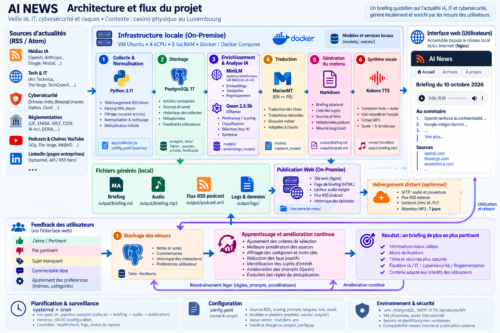

# AI News

Veille RSS/Atom sur l’IA, l’IT, la cybersécurité et les risques, avec un contexte
métier de casino physique au Luxembourg. Le projet produit un briefing en anglais
et en français, des mails HTML et texte, des MP3 et des flux RSS de podcast.
Les modèles fonctionnent localement après téléchargement.



Le schéma distingue les traitements locaux, les modèles, les services externes
et les opérations manuelles. Les retours utilisateurs sont stockés séparément
du pipeline éditorial : aucun apprentissage automatique n'est implémenté.

## Fonctionnement

1. Collecte des sources activées et normalisation des articles dans PostgreSQL.
2. Scoring par mots-clés, fraîcheur, longueur du contenu et bonus métier.
3. Filtrage des articles, règles de veille et détection des indices CVE/CVSS.
4. Classification et regroupement des événements avec MiniLM.
5. Arbitrage des doublons, évaluation et synthèse anglaise avec Qwen via Ollama.
6. Traduction française avec MarianMT et protection des termes du glossaire.
7. Génération des Markdown, mails, MP3 et podcasts.

Les éditions EN et FR partagent la même sélection et les mêmes sources.
Les titres et noms des sources restent dans leur langue d’origine.
Les priorités P1/P2 sont des indices textuels, pas des confirmations de gravité
ou d’exploitation. Une sélection peut contenir moins d’événements que le plafond.

Le contrôle inter-journalier compare les briefings précédents avec MiniLM puis
Qwen pour distinguer répétition et évolution substantielle. Il utilise les
Markdown existants, sans fichier d’historique supplémentaire.

Le pipeline lit `unique_articles`, qui déduplique les lignes par GUID. Le
regroupement en événements est une étape distincte : identifiants CVE/ZDI,
URL, titres et similarité sont examinés avant les arbitrages Qwen. Les sujets
retenus sont répartis entre alertes de sécurité et veille stratégique ; les
alertes P1/P2 non retenues peuvent apparaître dans une annexe de liens.

Les réglages fournis sont une fenêtre de 24 heures, un score historique minimum
de 35 avec exceptions pour la veille et les vulnérabilités, un plafond de
15 événements et une cible de 50 candidats pour l'évaluation Qwen. L'historique
couvre 7 jours avec une présélection sémantique à 0,72. Les cibles par catégorie
sont souples, avec une dérogation pour les indices P1. Ces réglages sont dans
`briefing.briefing` ; le nombre réellement publié peut être inférieur au plafond.

## Installation

Prérequis : Linux, Docker avec Compose v2, `curl`, accès Internet et espace disque
pour les modèles. Toutes les commandes partent de la racine du dépôt ; ajouter
`sudo` devant `docker` si nécessaire.

```bash
./init-repo.sh
```

Le script prépare les dossiers, crée `.env` s’il est absent, télécharge les modèles
et voix, construit les images, démarre PostgreSQL et Ollama et applique les scripts
SQL. Il conserve le `.env` et les fichiers de modèles non vides déjà présents.
Il ne lance ni collecte, ni envoi de mail, ni publication.

```bash
# Modèles Kokoro uniquement
./init-repo.sh --models-only
# Installation avec les voix Piper
./init-repo.sh --with-piper
# Modèles Kokoro et Piper uniquement
./init-repo.sh --models-only --with-piper
```

PostgreSQL et Ollama sont persistants ; les autres services s’exécutent à la demande.
Les limites mémoire s’additionnent : 6 Go pour `embeddings`, 4 Go pour Ollama et
2 Go pour `audio` dans Compose. Les modèles sont exclus de Git.

L'initialisation applique les scripts SQL `001` à `006`, télécharge Qwen 2.5:3b,
MiniLM multilingue et MarianMT EN→FR, et prépare les modèles audio. Elle écrit en
base et télécharge des fichiers : ce n'est pas une commande de diagnostic.
L'option `--models-only` prépare uniquement les modèles audio.

### Services et persistance

| Service Compose | Exécution et stockage |
|---|---|
| `postgres` | PostgreSQL 17 persistant, volume `postgres_data` |
| `collector` | À la demande ; collecte, normalisation et scoring ; dépôt monté dans `/workspace` |
| `embeddings` | Profil `ai` ; sélection, synthèse et traduction ; cache `embeddings_models` et `/output` |
| `ollama` | Profil `ai` ; serveur local Qwen, volume `ollama_models`, limite 4 Go |
| `audio` | Profil `ai` ; Kokoro ou Piper ; modèles, voix et `/output` montés depuis l'hôte |
| `podcast` | Profil `ai` ; SFTP, RSS, couverture et états par langue ; limite 256 Mo |
| `mailer` | Profil `mail` ; SMTP, aperçus et diagnostic du healthcheck |
| `xtts` | Profil optionnel `xtts`, limite 6 Go ; hors pipeline quotidien |

Les scripts d'orchestration et systemd tournent sur l'hôte. Aucun serveur web,
planificateur ou traducteur autonome supplémentaire n'est défini dans Compose.
Le PHP de feedback et les fichiers du podcast sont hébergés à distance.

## Configuration

Les réglages applicatifs sont dans `config.yaml`, chargés par `project_config.py`.
Les secrets et adresses de déploiement restent dans `.env`.

| Section | Rôle |
|---|---|
| `collection` | Sources RSS/Atom et désactivation automatique |
| `scoring` | Poids communs des domaines, mots-clés et plafonds du score |
| `briefing.briefing` | Langues, sélection, historique et déduplication |
| `briefing.prompts` | Instructions Qwen et gabarits de messages |
| `briefing.llm` | Modèle et température |
| `briefing.scoring` | Bonus et contexte métier |
| `semantic_scoring` | Descriptions des domaines utilisées pour la classification MiniLM |
| `watchlists` | Inclusions, exclusions et technologies suivies |
| `glossary` | Termes protégés et traductions |
| `audio` | Moteur, voix, pauses et débit |
| `podcast` | Métadonnées, éditions et rétention |
| `mail` | SMTP, objets et options de feedback |
| `healthcheck` | Calendrier, délai, journal, alertes et étapes autorisées à la reprise |

`scoring.domain_weights` alimente le bonus métier et est exposé aux profils
sémantiques par le chargeur. La classification actuelle de MiniLM choisit le
domaine par similarité, sans appliquer ces poids. Les poids doivent être des
nombres finis positifs ou nuls. `scoring.topics[].max_points` définit les plafonds
du score par mots-clés.

`briefing.briefing.strategic_topics` définit les motifs de reconnaissance, leur
ordre de priorité, la limite de résumé analysée et le thème de repli.
Le premier motif correspondant détermine le thème. Cet ordre sert aussi à
répartir les candidats entre thèmes.

Les prompts et leurs champs sont validés au chargement. Conserver les noms des
champs entre accolades ; doubler les accolades pour un JSON littéral (`{{`, `}}`).
MiniLM et MarianMT reçoivent des textes à encoder ou traduire, sans prompt
conversationnel.

Modifier le YAML seul ne régénère aucune édition et n’envoie aucun mail immédiat.
Les services et tâches planifiées prennent en compte les réglages au lancement
suivant, notamment les autorisations de reprise du healthcheck.
Après modification du code ou des dépendances, reconstruire les images concernées :

```bash
docker compose --profile ai --profile mail build collector embeddings audio podcast mailer
# Alternative XTTS uniquement
docker compose --profile xtts build xtts
```

Le collecteur monte le dépôt en écriture pour mettre à jour les sources ; les autres
services lisent `config.yaml` en lecture seule. Le code exécuté reste celui des
images : une modification Python nécessite leur reconstruction. Pour une copie
de configuration, utiliser `AI_NEWS_CONFIG` en Python local ou `--config` pour
mail, audio, podcast et le module de healthcheck.

La CLI `python -m project_config SECTION CLE` affiche uniquement une valeur
scalaire, par exemple `python -m project_config healthcheck grace_hours`.
Pour lire une section complexe, utiliser `load_section` depuis Python.

## Collecte et scoring

```bash
# Écrit les articles et les résultats de collecte en base
docker compose run --rm -T collector
# Recalcule les scores en base
docker compose run --rm -T collector python -m app.scorer
```

Les sources utilisent `collection.sources[].url` et `enabled`.
Une source désactivée entraîne la suppression de ses articles pendant la collecte.
La désactivation automatique utilise le seuil de `collection.source_health` : les
erreurs de téléchargement ou de lecture comptent, les erreurs SQL ne comptent pas.
Un flux valide sans article n’est pas un échec.

La mise à jour du YAML est verrouillée, atomique et sauvegardée dans
`config.yaml.bak`. Si elle échoue, la purge automatique n’est pas effectuée.
Un article de même source et de même GUID n’est pas réécrit.

`briefing.scoring.rescore_all` active le recalcul total ; sinon seuls les scores
absents ou datant de plus de douze heures sont traités.

## Briefing et éditions quotidiennes

```bash
# Prépare le jour courant : collecte, scoring, Markdown, aperçus HTML et MP3
# Écrit en base et dans output/, sans SMTP ni SFTP
sudo ./run-daily.sh --prepare
# Pipeline quotidien avec envoi des mails et publication SFTP
sudo ./run-daily.sh
```

Les deux Markdown sont préparés avant les envois. Le pipeline traite ensuite le
mail, l’audio et le podcast anglais, puis français. Il impose le moteur Kokoro.

```text
output/daily/AAAA-MM-JJ/
├── generated
├── en/
│   ├── briefing.md
│   ├── briefing-email.html
│   ├── AAAA-MM-JJ-briefing.mp3
│   ├── podcast.xml
│   ├── mail.done
│   ├── audio.done
│   └── podcast.done
└── fr/
    └── mêmes fichiers
```

Les marqueurs permettent la reprise sans répéter les étapes terminées. Les aperçus
ne créent pas de marqueur d’envoi. La date est fixée en Europe/Paris au début du
pipeline. Les dossiers quotidiens ne sont pas purgés automatiquement.

`generated` valide les deux Markdown ensemble ; il n'existe pas de marqueur
individuel pour chaque synthèse ou pour la traduction FR. Les fichiers Markdown
sont remplacés atomiquement, langue par langue. Une erreur de traduction peut
donc laisser l'EN présent, le FR absent et aucun marqueur `generated`.

MarianMT traduit les titres et synthèses par phrases, avec protection des termes
du glossaire. Une entrée trop longue, une sortie vide ou limitée, ou un marqueur
perdu/dupliqué bloque la génération FR. `glossary.case_sensitive_terms` permet
de distinguer un sigle d'un mot courant, notamment `FIRST` de `first`.
Les titres des sources et leurs liens sont conservés sans traduction.

Hors pipeline, sans `BRIEFING_DAILY_DIR`, le chemin de base est
`BRIEFING_OUTPUT`, par défaut `/output/briefing.md`. Avec les deux langues,
les fichiers deviennent `/output/briefing-en.md` et `/output/briefing-fr.md`.

Pour évaluer la sélection seule :

```bash
docker compose --profile ai run --rm -T \
  -e BRIEFING_DRY_RUN=1 embeddings python -m embeddings.briefing
```

Cette commande charge MiniLM et appelle Qwen, sans synthèse, traduction ni écriture
Markdown. `embeddings.worker` est un diagnostic de similarité, sans scoring ni
stockage de groupes ; il n'est pas appelé par `run-daily.sh`. La sélection et
les évaluations du briefing ne sont pas persistées dans les tables de feedback.

## Éditions rétrospectives

```bash
# Remplacer la date par une journée passée
sudo ./run-daily.sh --date 2026-10-10
# Publication des podcasts, sans mail
sudo ./run-daily.sh --date 2026-10-10 --publish
# Envoi des mails, sans publication
sudo ./run-daily.sh --date 2026-10-10 --send-mail
```

La préparation utilise les articles et scores disponibles en base, sans collecte
ni recalcul. La sélection couvre la journée civile Europe/Paris selon
`published_at`, y compris les journées de 23 ou 25 heures. Les modèles et la
configuration sont ceux du lancement.

Préparer plusieurs journées dans l’ordre chronologique. Les éditions ultérieures
ne sont pas réécrites. Des Markdown présents sans marqueur `generated` arrêtent
la préparation rétrospective ordinaire pour permettre leur vérification.
Le mode `--healthcheck` suit les règles de reprise décrites plus bas et peut
relancer la génération bilingue complète. La publication est limitée par la
rétention du podcast ; les liens de feedback suivent leur propre expiration.

## Mail

Renseigner le serveur dans `mail.smtp` et les variables suivantes dans `.env` :

```dotenv
SENDER="AI News <ai-news@example.com>"
RECIPIENT=destinataire@example.com
SMTP_USERNAME=identifiant_smtp
SMTP_PASSWORD=mot_de_passe_smtp
```

Les objets peuvent être définis par langue ; `{date}` utilise Europe/Paris.
SMTP prend en charge STARTTLS et SSL avec vérification du certificat.

```bash
# Aperçu local HTML, sans connexion SMTP
docker compose --profile mail run --rm -T mailer --dry-run
# Envoi réel du Markdown configuré
docker compose --profile mail run --rm -T mailer
```

Chaque envoi manuel sans `--dry-run` envoie un nouveau mail. Les marqueurs de
reprise sont gérés par le pipeline quotidien, pas par cette commande manuelle.

## Audio et podcast

Kokoro utilise les modèles et voix de `audio/models/kokoro/`. Le MP3 est mono,
à 22 050 Hz. Les débits acceptés sont `24k`, `32k`, `40k`, `48k` ; les pauses sont
configurables entre 0 et 10 000 ms. La date préfixe le nom de sortie.

```bash
# Génère le MP3 à partir du Markdown configuré
docker compose --profile ai run --rm -T audio
```

Piper nécessite une voix ONNX et son fichier `.onnx.json`. XTTS utilise le service
`xtts`, son cache de modèle et un fichier WAV de référence. Ces alternatives
s’utilisent hors du pipeline quotidien.

Le podcast publie le MP3, la couverture et un RSS par langue : `/en/podcast.xml`
et `/fr/podcast.xml`. Configurer les métadonnées dans `podcast`, les identifiants
SFTP et `PODCAST_SITE_URL` dans `.env`. Cette URL est la base commune, sans suffixe
de langue ; le code ajoute `/en/` ou `/fr/`. Fournir `podcast/cover.jpg`.
Le Compose actuel monte `/home/seb/.ssh/known_hosts` vers
`/root/.ssh/known_hosts` : ce fichier hôte doit exister et contenir la clé
vérifiée du serveur SFTP. La variable `PODCAST_KNOWN_HOSTS` créée par
l'initialisation n'est pas utilisée par ce montage.

```bash
# Vérifie les fichiers et prépare le RSS local, sans transfert
docker compose --profile ai run --rm -T podcast --language fr --dry-run
# Publication SFTP réelle
docker compose --profile ai run --rm -T podcast --language fr
```

Le contrôle à blanc nécessite le Markdown, le MP3 daté et la couverture.
La publication transfère les fichiers avant le remplacement atomique du RSS.
Les fichiers MP3 distants expirés sont supprimés selon `podcast.retention_days`.

Le nom distant inclut la date et l’empreinte SHA-256 du MP3. Publier le même fichier
pour la même date conserve une seule entrée RSS et sa date de publication.
Conserver `podcast/state/` pour préserver les épisodes.

Les états sont séparés : `episodes-en.json` et `episodes-fr.json`. Le mode
`podcast --dry-run` écrit le RSS local, mais ne transfère rien et ne sauvegarde
pas l'état des épisodes. La publication réelle transfère d'abord le MP3 et la
couverture, remplace le RSS distant atomiquement, purge uniquement les anciens
MP3 de briefing reconnus, puis sauvegarde l'état local. Le serveur doit prendre
en charge le renommage POSIX SFTP. Un contenu audio différent pour la même date
peut créer un épisode supplémentaire.

## Feedback

Le mail peut afficher six motifs par article : utile, hors sujet, non applicable,
superficiel ou promotionnel, sans nouveauté, déjà couvert. Les liens sont signés
avec `FEEDBACK_SIGNING_SECRET` et pointent vers `FEEDBACK_URL`, définis dans `.env`.
Le secret doit correspondre à celui du récepteur PHP et contenir au moins 32 octets.

Les options de `mail.feedback` sont :

| Option | Rôle |
|---|---|
| `enabled` | Active les liens quand l’URL est renseignée ; valeur par défaut : `true` |
| `link_days` | Durée depuis la date d’édition ; valeur par défaut : 90 jours |
| `newsletter_enabled` | Active les choix « Équilibrée », « Trop cyber », « Trop IA » ; `true` dans le YAML fourni, `false` si absent |

Les boutons globaux portent sur la journée entière, avec une identité commune
aux éditions EN/FR. Les boutons d'article portent sur l'événement publié et
ses sources. Les deux types de votes restent distincts. Le même secret de
signature est utilisé pour ces deux types de liens, avec des champs et motifs validés.

Le récepteur est `web/public/feedback.php` (PHP >= 8.1). Sa configuration privée,
ses secrets et ses fichiers de votes restent hors de la racine web ; un exemple
est fourni dans `web/private.example/config.php`. En mode GET direct, la durée
`link_seconds` doit correspondre à `mail.feedback.link_days`.

Le déploiement du PHP est distinct de celui du podcast : ni Compose ni
`run-daily.sh` ne le mettent à jour. La version distante doit reconnaître les
motifs `newsletter_*` et `briefing_date` pour accepter les boutons globaux.
Configurer `FEEDBACK_PRIVATE_CONFIG` sur l'hébergement, ou adapter la constante
`PRIVATE_CONFIG`, sans remplacer la configuration privée lors d'une mise à jour.
Le secret d'API des actions `pull`/`ack` est distinct du secret des liens.

Par défaut, GET affiche une confirmation et POST enregistre le vote. Le mode
`require_confirmation: false` permet le vote direct mais expose aux votes de
scanners mail. Ne pas suivre les liens réels pour un contrôle automatique.

`feedback/importer.py` fournit les classes `Client`, `Store` et la fonction
`synchronize` : récupération HTTPS authentifiée, validation, transaction locale,
puis acquittement des seuls identifiants stockés. L'acquittement supprime les
JSON concernés de la file distante. Les conflits ne sont pas acquittés.
Les votes d'article sont enregistrés dans `feedback_returns` et les votes
globaux dans `feedback_newsletter_returns`. Les vues `feedback_effective_*`
retiennent le dernier choix par présentation.

Cet importeur est une bibliothèque, sans CLI ni planification intégrée. Aucune
section de configuration d'import automatique n'est fournie. Le pipeline ne
personnalise pas la sélection à partir des votes et n'entraîne aucun modèle.
Les tables de candidats, de cache et d'historique de feedback ne constituent
pas, à elles seules, un système d'apprentissage actif.

`app/import_feedback_archive.py` est un outil manuel distinct : il rattache des
présentations bilingues provenant d'archives de tests déjà présentes dans
`feedback_runs`, sans inventer de caractéristiques ML historiques ni modifier
les votes. Son option `--archive-id` désigne une archive existante ; son exécution
écrit en base et n'est pas une commande d'observation.

## Planification et journaux

Sur Linux avec systemd, cron et logrotate :

```bash
sudo ./post-install.sh
```

Le script installe le service `ai-news.service`, un cron quotidien à **04:00 selon
le fuseau du serveur** et la rotation des journaux. Il ne lance pas le pipeline
immédiatement. Le service exécute le pipeline complet, avec mail et publication.

```bash
sudo systemctl status ai-news.service
sudo journalctl -u ai-news.service -f
sudo tail -f /var/log/ai-news.log
```

Le verrou `/run/ai-news.lock` empêche deux pipelines simultanés. Le journal
`/var/log/ai-news.log` reçoit les sorties et erreurs ; logrotate conserve sept
archives avec compression différée. Les journaux de PostgreSQL et Ollama restent
accessibles par `docker compose logs`.

## Healthcheck et reprise des étapes

`mailer/healthcheck.py` inspecte les fichiers et marqueurs d'une édition. Il ne
répare rien par lui-même. `run-daily.sh --healthcheck` utilise ce diagnostic,
reprend les étapes autorisées du pipeline existant sous le même verrou, puis
réévalue l'édition. Une erreur arrête les traitements ; le contrôle final tente
d'envoyer une alerte si l'édition reste incomplète.

| Réglage `healthcheck` | Valeur fournie |
|---|---|
| `calendar` | `hourly`, calendrier systemd installé par `post-install.sh` |
| `timezone` | `Europe/Paris`, à aligner avec le fuseau du cron quotidien |
| `daily_start_hour` / `grace_hours` | `4` / `2` : édition attendue après 06:00 |
| `daily_dir` | `/output/daily` ; requis par l'orchestrateur actuel |
| `log_path` | `/var/log/ai-news.log` |
| `log_tail_lines` / `log_max_bytes` | 200 lignes / 65 536 octets maximum lus |
| `repair.enabled` | `true` ; reprise désactivée si cette option est absente |
| `repair.stages` | `markdown`, `preview`, `mail`, `audio`, `podcast` |

Avant l'échéance, le contrôle porte sur la veille ; après, sur le jour courant.
Il ne parcourt pas automatiquement toutes les anciennes journées. `--date`
permet d'en choisir une, y compris aujourd'hui, sans attendre l'échéance.

### Diagnostic sans réparation

```bash
# Lecture de l'état et de la politique, sans SMTP ni écriture de sortie/journal
./run-daily.sh --healthcheck --dry-run
# Même diagnostic pour une journée précise
./run-daily.sh --healthcheck --dry-run --date 2026-10-10
```

Ces commandes créent des conteneurs temporaires. La liste d'étapes affichée par
`--repair-plan` indique les autorisations, pas une liste de réparations garanties.

### Reprise réelle et surveillance horaire

```bash
# Écrit les sorties/marqueurs ; peut envoyer des mails et publier par SFTP
sudo ./run-daily.sh --healthcheck
# Reprise d'une journée précise, avec les mêmes effets possibles
sudo ./run-daily.sh --healthcheck --date 2026-10-10
# Installe et active uniquement le service/timer de surveillance
sudo ./post-install.sh --healthcheck-only
```

Cette installation est distincte de `sudo ./post-install.sh`, qui installe le
cron quotidien. Elle exige l'image `mailer` à jour, le journal existant,
`daily_dir: /output/daily` et un fuseau identique à celui du serveur. Elle crée
`ai-news-healthcheck.service` et `ai-news-healthcheck.timer` et active le timer.
Modifier `calendar` nécessite de relancer cette installation. Les autres réglages
sont relus aux contrôles suivants.

| Marqueur absent | Étape reprise si autorisée |
|---|---|
| `generated` | Sélection, synthèse et génération EN/FR complètes |
| `<langue>/mail.done` | Mail de cette langue |
| `<langue>/audio.done` | Audio de cette langue |
| `<langue>/podcast.done` | Publication du podcast de cette langue |

La reprise ne relance ni collecte ni scoring. L'aperçu HTML manquant peut être
recréé sans envoi. Sans `generated`, la génération peut remplacer les Markdown
partiels existants ; elle est refusée si un marqueur de mail, audio ou podcast
atteste déjà une étape aval terminée. Un marqueur `generated` présent avec un
Markdown manquant, ou un podcast terminé sans marqueur audio, arrête la reprise.
Un marqueur audio présent avec MP3 manquant déclenche le diagnostic, mais le
mode healthcheck ne relance pas cette étape déjà marquée terminée.

Un verrou occupé diffère le contrôle sans interrompre le pipeline. Une alerte
est envoyée à `RECIPIENT` dans `.env`, avec l'objet configuré, les étapes restantes,
le statut de reprise et une pièce jointe contenant la fin du journal. Les URL
et secrets reconnus sont masqués. Cet extrait peut concerner d'autres exécutions
et ne pas contenir une ancienne panne après rotation. Une alerte est répétée
au contrôle suivant si l'édition attendue reste incomplète ; aucune alerte n'est
envoyée si elle est complète. Une panne Docker ou SMTP peut empêcher l'alerte ;
consulter alors le journal systemd.

Un marqueur absent ne prouve pas que l'effet externe n'a pas eu lieu : une
reprise du mail peut produire un doublon après une interruption postérieure à
l'acceptation SMTP. Les marqueurs n'attestent ni la réception des mails ni
l'accessibilité distante des podcasts. La rétention du podcast reste applicable
aux journées anciennes.

```bash
systemctl list-timers ai-news-healthcheck.timer
sudo journalctl -u ai-news-healthcheck.service -n 100
# Arrête la surveillance automatique, sans supprimer les données
sudo systemctl disable --now ai-news-healthcheck.timer
```

Mettre `healthcheck.repair.enabled: false` conserve le diagnostic et les alertes,
sans reprise automatique.

## Repères du dépôt

| Emplacement | Responsabilité |
|---|---|
| `app/collector.py`, `normalizer.py`, `source_health.py` | Collecte, texte normalisé, désactivation sûre des sources |
| `app/scorer.py` | Score historique et bonus métier en base |
| `app/sql/001` à `006` | Sources/articles, normalisation, scoring, vue GUID et tables de feedback |
| `embeddings/briefing.py` | Filtres, regroupement, historique, Qwen, MarianMT et Markdown |
| `embeddings/prompts.py`, `watchlist.py`, `vulnerability_detector.py`, `glossary.py` | Validation des prompts et règles du briefing |
| `embeddings/worker.py` | Diagnostic manuel MiniLM, sans persistance |
| `audio/tts.py` | Extraction Markdown, synthèse vocale et conversion MP3 |
| `mailer/send.py`, `feedback_links.py`, `healthcheck.py` | Mail, liens signés et inspection des étapes |
| `podcast/publish.py` | Épisodes, RSS, transfert SFTP et rétention |
| `web/public/feedback.php`, `web/private.example/config.php` | Récepteur web et exemple de configuration privée |
| `feedback/importer.py`, `app/import_feedback_archive.py` | Synchronisation des votes et rattachement manuel d'archives |
| `run-daily.sh`, `init-repo.sh`, `post-install.sh` | Orchestration, initialisation et planification sur l'hôte |
| `project_config.py`, `config.yaml` | Accès commun et configuration applicative |
| `tests/` | Tests unitaires et intégrations optionnelles PHP/PostgreSQL isolées |

## Limites et repères

Les articles sans date sont exclus du briefing. Une date RSS erronée peut fausser
la sélection. La vue `unique_articles` déduplique par GUID ; le briefing déduplique
les événements. Les synthèses et traductions demandent une vérification humaine.

Une synthèse Qwen en erreur peut retirer un événement des deux éditions ; une
erreur MarianMT bloque l'édition FR entière. L'applicabilité à l'infrastructure
réelle n'est pas déduite des noms de produits : elle reste « inconnue ».
La table `glossary.translations` est chargée, mais le traducteur actuel restaure
les termes protégés à l'identique sans appliquer cette table de substitutions.
Les caches de modèles sont locaux ; le premier chargement peut nécessiter
Internet si les modèles ne sont pas disponibles. Aucun lecteur web ou portail
de briefing n'est généré par le code présent.

Les scripts du schéma PostgreSQL sont dans `app/sql/`. Les tests sont dans `tests/`.
Les tests PHP peuvent démarrer un récepteur temporaire sur l'interface locale ;
ceux de PostgreSQL sont optionnels via `AI_NEWS_TEST_PG_BIN` et
`AI_NEWS_TEST_PG_SHARE`. Leur présence ne vaut pas validation de l'installation.
Les règles de contribution et de validation sont dans [AGENTS.md](AGENTS.md).
