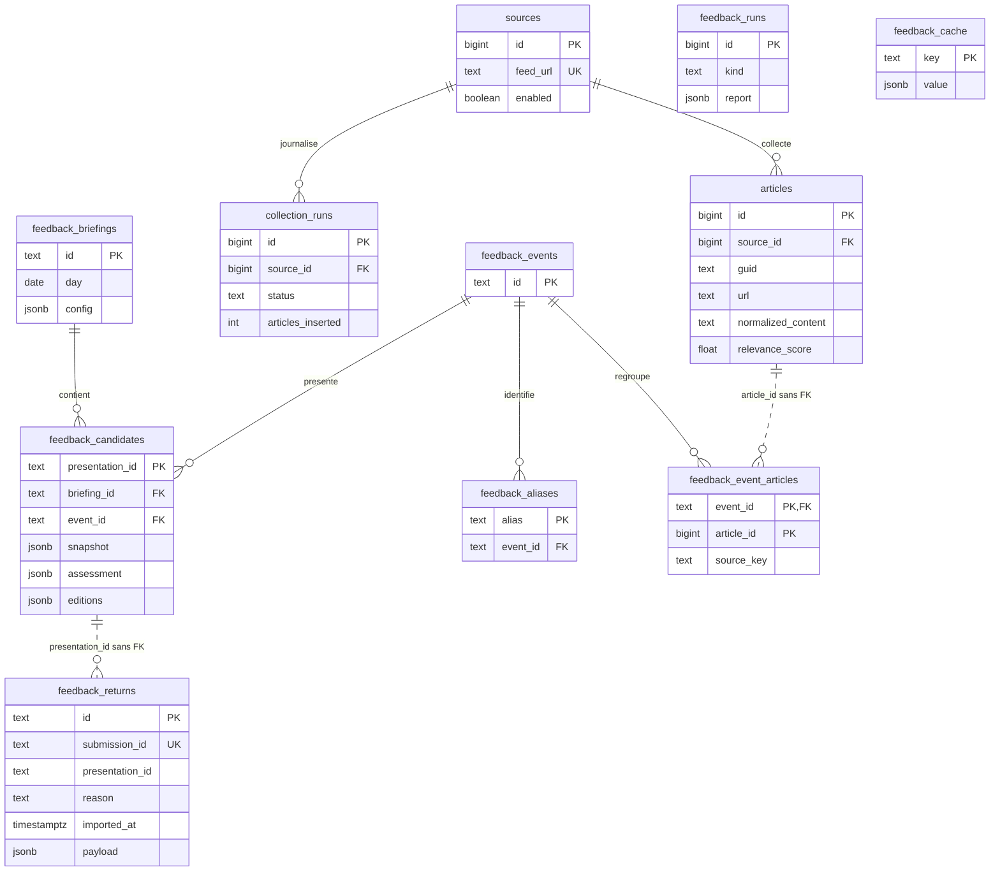

# AI News

Veille RSS/Atom sur l’IA, l’IT, la cybersécurité et les risques, avec un contexte métier de casino physique au Luxembourg. Le projet produit un briefing français, un MP3 et, en option, un podcast publié par SFTP.

## Flux de traitement

```text
config.yaml : collection.sources
  → Collecte RSS/Atom et normalisation HTML
  → PostgreSQL : articles et historique de collecte
  → Scoring par mots-clés, fraîcheur, longueur et bonus métier
  → Vue unique_articles : une ligne par GUID
  → Briefing : filtres, watchlists, détection CVE/CVSS
  → MiniLM : classification et regroupement des événements
  → Qwen via Ollama : déduplication complémentaire, évaluation et sélection
  → Qwen : titres et résumés anglais
  → MarianMT + glossaire : traduction française
  → output/briefing.md
  → Mail HTML + texte via SMTP (optionnel)
  → Kokoro : output/AAAA-MM-JJ-briefing.mp3
  → SFTP : MP3, illustration et podcast.xml
```

La collecte et le scoring écrivent en base. Le briefing lit la base et écrit le Markdown ; ses évaluations Qwen ne sont pas conservées en base. Les modèles fonctionnent localement après téléchargement initial. Les priorités P1/P2 sont des signaux textuels provisoires, à vérifier dans les sources.

Le regroupement du briefing est autonome. `embeddings.worker` est un outil de diagnostic qui affiche des similarités ; il ne calcule aucun score et ne stocke aucun groupe.

## Installation

Toutes les commandes partent de la racine du dépôt. Docker et Docker Compose avec profils sont nécessaires ; ajouter `sudo` devant `docker` si votre compte l’exige.

### Initialisation automatique (recommandée)

Installer Docker avec le plugin Compose v2 et `curl`, puis depuis le dépôt cloné :

```bash
./init-repo.sh
```

Le script crée `output/`, `podcast/state/`, `audio/voices/` et les dossiers de modèles. Si `.env` est absent, il le crée avec un mot de passe PostgreSQL aléatoire. Il télécharge Kokoro et les voix FR/EN, construit les images (mailer inclus), démarre PostgreSQL et Ollama, applique les scripts SQL et télécharge Qwen, MiniLM et MarianMT. MiniLM et MarianMT sont conservés dans le volume `embeddings_models`, Qwen dans `ollama_models`.

Internet et plusieurs Go de disque sont nécessaires. Le script s’arrête à la première erreur et peut être relancé : les modèles audio non vides déjà présents et le `.env` existant sont conservés. Ne pas changer le mot de passe d’un PostgreSQL déjà initialisé en modifiant seulement `.env`.

```bash
# Télécharger seulement Kokoro, sans Docker ni initialisation SQL
./init-repo.sh --models-only
# Initialisation complète avec les voix Piper FR/EN configurées
./init-repo.sh --with-piper
# Télécharger seulement Kokoro et Piper
./init-repo.sh --models-only --with-piper
```

Sources : [Kokoro-82M](https://huggingface.co/hexgrad/Kokoro-82M/tree/main) et [Piper voices](https://huggingface.co/rhasspy/piper-voices/tree/main). Le script contient les commandes `curl` de téléchargement. Ajouter manuellement toute voix personnalisée et adapter `config.yaml`.

Aucune collecte, aucun mail et aucune publication ne sont lancés. Compléter les configurations SMTP/SFTP et `.env` avant le pipeline quotidien. Le fichier `podcast/known_hosts` est créé vide : ajouter la clé vérifiée du serveur avant publication. Pour utiliser un fichier existant, définir `PODCAST_KNOWN_HOSTS=/chemin/absolu/known_hosts` dans `.env`.

XTTS reste optionnel : construire le service dédié et lancer la commande décrite plus bas pour télécharger son modèle. Fournir aussi `audio/voices/homme_fr.wav` ; aucune voix de référence n’est générée par le script.

Les étapes suivantes détaillent l’installation manuelle.

### 1. Préparer la configuration

```bash
cd /opt/ai-news
mkdir -p output podcast/state
# Créer ou compléter .env avec votre éditeur.
```

Variables attendues dans `.env` (remplacer les exemples) :

```dotenv
POSTGRES_DB=ai_news
POSTGRES_USER=ai_news
POSTGRES_PASSWORD=mot_de_passe_a_remplacer
POSTGRES_PORT=5432
# Seulement pour la publication SFTP :
PODCAST_SFTP_USER=utilisateur_sftp
PODCAST_SFTP_PASSWORD=mot_de_passe_sftp
```

### 2. Construire et démarrer les services

```bash
docker compose --profile ai config --quiet
docker compose --profile ai build collector embeddings audio podcast
docker compose --profile ai up -d --wait postgres ollama
docker compose exec ollama ollama pull qwen2.5:3b
```

PostgreSQL et Ollama restent démarrés. Les autres services s’exécutent à la demande. Le profil `xtts` est une alternative audio distincte. Les limites mémoire des conteneurs s’additionnent : 6 Go pour `embeddings`, 4 Go pour Ollama, 2 Go pour `audio` ; surveiller la mémoire sur une machine de 8 Go.

### 3. Initialiser le schéma SQL

Compose ne monte pas de scripts d’initialisation PostgreSQL. Sur une base neuve, appliquer les cinq fichiers dans l’ordre :

```bash
for sql in app/sql/001_initial_schema.sql \
           app/sql/002_normalized_content.sql \
           app/sql/003_article_scoring.sql \
           app/sql/004_unique_articles.sql \
           app/sql/005_feedback.sql; do
  docker compose exec -T postgres sh -c \
    'psql -v ON_ERROR_STOP=1 -U "$POSTGRES_USER" -d "$POSTGRES_DB"' < "$sql" || break
done
```

Vérifier que chaque fichier s’est terminé sans erreur avant de poursuivre. Les scripts actuels utilisent `IF NOT EXISTS` ou `CREATE OR REPLACE VIEW`.

## Exécution étape par étape

### 1. Collecter et normaliser

```bash
docker compose run --rm -T collector
```

Le collecteur parcourt les sources activées, insère les nouveaux articles, puis normalise le HTML. Un article existant de même source et même GUID n’est pas mis à jour. Les erreurs de flux sont enregistrées dans `collection_runs` et les autres flux continuent.

**Comportement actuel : une source avec `enabled: false` entraîne la suppression de ses articles en base au début de la collecte.**

Le catalogue et les autres configurations du collecteur sont montés depuis l’hôte. Une modification de `config.yaml` est prise en compte à la prochaine collecte. Après modification du code ou des dépendances, reconstruire :

```bash
docker compose build collector
```

### Désactivation automatique des flux défaillants

La section `collection` de `config.yaml` contient la politique :

```yaml
collection:
  source_health:
    auto_disable: true
    consecutive_failures: 3
```

Après trois échecs consécutifs de téléchargement ou de lecture d’un flux, la source passe à `enabled: false` dans le YAML et en base. Ses articles sont supprimés de la base ; la source et son historique `collection_runs` sont conservés. Une collecte réussie, même partielle, interrompt la série d’échecs. Un flux valide sans article n’est pas une erreur. Les erreurs SQL/internes ne comptent pas pour la désactivation automatique.

Le fichier YAML est modifié sous verrou et remplacé atomiquement ; sa version précédente est conservée dans `config.yaml.bak`. Les sources suivantes continuent d’être collectées. Les modifications restent visibles dans Git pour revue. Si l’écriture du YAML échoue, la source n’est pas automatiquement purgée en base.

Pour réactiver une source après correction de son URL ou résolution du problème, remettre `enabled: true` dans le YAML : la prochaine collecte la réactive en base. Les articles seront récupérés à nouveau selon le contenu disponible du flux. Définir `auto_disable: false` pour conserver uniquement l’enregistrement des erreurs.

Après cette mise à jour, reconstruire le collecteur : `sudo docker compose build collector`. Les compteurs utilisent les erreurs de flux identifiées par cette version ; les anciennes erreurs non catégorisées ne déclenchent pas de désactivation immédiate.

### 2. Calculer les scores

```bash
docker compose run --rm -T collector python -m app.scorer
```

Le score combine `scoring.topics` et le bonus métier de `briefing.scoring` dans `config.yaml`. Il est utilisé pour filtrer les candidats du briefing. `briefing.scoring.rescore_all: true` recalcule toute la base ; sinon les scores absents ou anciens de plus de 12 heures sont traités.

Pour reprendre uniquement une normalisation incomplète :

```bash
docker compose run --rm -T collector python -m app.normalize_articles
```

### 3. Vérifier la sélection sans générer le briefing

```bash
docker compose --profile ai run --rm -T \
  -e BRIEFING_DRY_RUN=1 embeddings python -m embeddings.briefing
```

Ce contrôle charge MiniLM et appelle Qwen pour la déduplication et l’évaluation. Il ne fait ni synthèse, ni traduction, ni écriture du Markdown.

### 4. Générer le briefing

```bash
docker compose --profile ai run --rm -T \
  -e BRIEFING_DRY_RUN=0 \
  -e BRIEFING_OUTPUT=/output/briefing.md \
  embeddings python -m embeddings.briefing
cat output/briefing.md
```

Le montage `./output:/output` conserve le résultat après suppression du conteneur. Sans `BRIEFING_OUTPUT`, le chemin par défaut est `/tmp/ai-news-briefing.md`, non persistant.

Le briefing filtre les articles récents selon le score et les règles de veille, puis regroupe les événements. Qwen évalue leur pertinence technique, leur importance et leur pertinence métier. La sélection applique les quotas thématiques et donne priorité aux P1 si l’option est activée. Les synthèses sont produites en anglais, puis traduites en français avec protection des termes techniques. Une annexe peut ajouter des liens vers des alertes P1/P2 évaluées mais non retenues. Le nombre publié peut être inférieur au plafond configuré.

### 5. Générer le MP3

Avec le moteur actuel `kokoro`, ces fichiers locaux sont nécessaires :

```text
audio/models/kokoro/config.json
audio/models/kokoro/kokoro-v1_0.pth
audio/models/kokoro/voices/ff_siwis.pt
```

Ils sont montés dans `/models`. Les modèles sont exclus de Git ; les télécharger avec `./init-repo.sh --models-only`. Le conteneur audio est configuré en mode Hugging Face hors ligne.

```bash
docker compose --profile ai run --rm -T audio
ls -lh "output/$(TZ=Europe/Paris date +%F)-briefing.mp3"
```

La section `audio` de `config.yaml` indique l’entrée Markdown, le moteur, la voix, les pauses et le débit. Le module préfixe automatiquement le nom de sortie par la date en Europe/Paris.

Le MP3 est mono, encodé à 22 050 Hz. Les paramètres se règlent dans le YAML : `pause_ms` entre articles, `title_pause_ms` après les titres et rubriques (0 à 10 000 ms), et `bitrate` parmi `24k`, `32k`, `40k`, `48k`. Vérifier à l’écoute les sigles, noms propres, CVE et anglicismes ; les pauses ne garantissent pas une prosodie particulière. Vérifier aussi les licences des modèles et voix utilisés.

Pour utiliser **Piper**, définir `audio.engine: piper` dans `config.yaml` et fournir le modèle ONNX ainsi que son fichier `.onnx.json` dans `audio/models/`. La voix française configurée est `/models/fr_FR-tom-medium.onnx`.

```bash
docker compose --profile ai build audio
docker compose --profile ai run --rm -T audio
```

Pour utiliser **XTTS**, définir `engine: xtts` et utiliser le service dédié, qui installe Coqui TTS. Le modèle nommé `tts_models/multilingual/multi-dataset/xtts_v2` utilise le cache `audio/models/xtts/` ; le premier lancement peut nécessiter un téléchargement. La référence vocale configurée est `audio/voices/homme_fr.wav`, montée dans `/voices/homme_fr.wav`.

```bash
docker compose --profile xtts build xtts
docker compose --profile xtts run --rm -T xtts
```

Repasser `engine: kokoro` pour le script quotidien, qui impose ce moteur. La génération audio produit le MP3 local ; la publication du RSS est réalisée à l’étape suivante.

### 6. Préparer et publier le podcast (optionnel)

Adapter la section `podcast` de `config.yaml` : métadonnées et rétention. Définir l’URL publique de base dans `.env` avec `PODCAST_SITE_URL` ; les éditions ajoutent automatiquement `/fr/` ou `/en/`. Fournir `podcast/cover.jpg` et les identifiants dans `.env`. La clé du serveur doit être vérifiée et présente dans le fichier `known_hosts` monté par Compose ; son chemin hôte par défaut est `./podcast/known_hosts`, configurable via `PODCAST_KNOWN_HOSTS` dans `.env`.

Utiliser une illustration JPEG carrée, idéalement 3 000 × 3 000 pixels en RGB. Vérifier `PODCAST_SFTP_REMOTE_PATH` depuis la session SFTP. L’adresse `PODCAST_EMAIL` apparaît publiquement dans le RSS : choisir une adresse de contact adaptée.

Pour récupérer la clé du serveur, `ssh-keyscan -p 22 ftp.cluster030.hosting.ovh.net` peut l’afficher ; vérifier son empreinte auprès d’une source de confiance avant de l’ajouter au fichier `known_hosts`.

Une clé SSH peut remplacer le mot de passe : la monter en lecture seule dans le service `podcast`, puis définir son chemin **dans le conteneur** via `.env` :

```dotenv
PODCAST_SFTP_KEY_FILE=/run/secrets/ovh_sftp_key
# Configuration SFTP et adresse publique du podcast :
PODCAST_SFTP_HOST=ftp.cluster030.hosting.ovh.net
PODCAST_SFTP_PORT=22
PODCAST_SFTP_REMOTE_PATH=/chemin/sftp/podcast
PODCAST_EMAIL=contact@example.com
PODCAST_SITE_URL=https://podcast.example.com/
```

Exemple de montage à ajouter aux volumes existants :

```yaml
      - /chemin/hote/cle_privee:/run/secrets/ovh_sftp_key:ro
```

`PODCAST_SFTP_PASSWORD` n’est pas nécessaire avec cette clé. Le programme de publication est `podcast/publish.py` ; son image est construite par `podcast/Dockerfile`.

Le montage `./podcast/state:/state` conserve l’historique RSS entre les exécutions. Chaque MP3 publié reçoit un nom unique `AAAA-MM-JJ-<empreinte SHA-256>-briefing.mp3`, utilisé aussi comme identifiant RSS. Plusieurs fichiers différents publiés le même jour ajoutent plusieurs épisodes ; republier le même fichier le même jour conserve une seule entrée et sa date initiale. Le fichier local reste `output/AAAA-MM-JJ-briefing.mp3`.

```bash
# Vérifie les fichiers et leur lecture, sans connexion SFTP.
docker compose --profile ai run --rm -T podcast --dry-run
# Publie le MP3, l’illustration et le RSS sur le serveur configuré.
docker compose --profile ai run --rm -T podcast
```

Après publication, vérifier le RSS à l’adresse configurée, <https://podcast.chauchard.info/fr/podcast.xml> pour le français et <https://podcast.chauchard.info/en/podcast.xml> pour l’anglais, ainsi que les liens MP3. La description des épisodes reprend les titres et les sources du Markdown (`**Sources :**`, `Sources:` ou listes de liens après un bloc sources). Si le format du briefing change, vérifier son interprétation avec `--dry-run`.

Le contrôle à blanc nécessite déjà le MP3 daté, le Markdown et l’illustration. La publication transfère d’abord le MP3 et l’illustration, puis remplace atomiquement le RSS avant de supprimer les MP3 distants expirés (7 jours calendaires actuellement). Seuls les MP3 de briefing expirés portant le nom daté historique ou le nouveau nom avec empreinte sont supprimés. Conserver `podcast/state/episodes.json` : les anciens épisodes ne sont pas reconstruits depuis le serveur. Si cet historique a déjà été perdu, cette correction conserve les nouveaux épisodes mais ne restaure pas les précédents.

### 7. Envoyer le briefing par mail (optionnel)

Le service `mailer` transforme `output/briefing.md` en mail HTML avec titres, listes, tableaux et liens sources. Il joint aussi une version texte dans le même message. L’envoi est indépendant de l’audio et du podcast.

Modifier la section `mail` de `config.yaml` (extrait) :

```yaml
input: /output/briefing.md
subject: "AI News — Briefing du {date}"
smtp:
  host: smtp.example.com
  port: 587
  security: starttls
  auth: true
  timeout: 30
```

`{date}` est remplacé par la date en Europe/Paris. Choisir `starttls` pour une connexion mise à niveau TLS (généralement port 587), ou `ssl` pour TLS dès la connexion (généralement port 465). La vérification du certificat est activée. `none` est réservé à un relais sans authentification (`auth: false`). L’expéditeur doit être autorisé par votre serveur SMTP.

Renseigner les variables dans `.env` :

```dotenv
SENDER="AI News <ai-news@example.com>"
RECIPIENT=destinataire@example.com
SMTP_USERNAME=identifiant_smtp
SMTP_PASSWORD=mot_de_passe_smtp
```

Compose transmet `SENDER`, `RECIPIENT`, `SMTP_USERNAME` et `SMTP_PASSWORD` au service mail. `SENDER` et `RECIPIENT` ont priorité sur les anciennes valeurs YAML. Le module lancé directement en Python attend ces variables dans son environnement ; il ne charge pas `.env` lui-même.

```bash
docker compose --profile mail build mailer
# Génère output/briefing-email.html sans connexion SMTP ni envoi.
docker compose --profile mail run --rm -T mailer --dry-run
# Envoie le briefing au destinataire configuré.
docker compose --profile mail run --rm -T mailer
```

L’aperçu ne nécessite pas d’identifiants SMTP. Chaque commande mail manuelle sans `--dry-run` envoie un nouveau mail ; le pipeline quotidien mémorise les étapes terminées. Le script `run-daily.sh` envoie le mail après la génération et la vérification du Markdown, avant les étapes audio et podcast. Un échec d’envoi arrête le pipeline. Construire l’image `mailer` et renseigner la configuration SMTP avant le prochain lancement quotidien.

## Éditions anglaise puis française

`briefing.languages: [en, fr]` active la génération des deux éditions. Les sources FR et EN restent collectées ensemble. Le regroupement utilise MiniLM multilingue ; Qwen synthétise une seule fois en anglais, puis MarianMT traduit les mêmes événements en français. Les liens et titres des sources restent dans leur langue d’origine. Une erreur de traduction arrête la génération plutôt que de publier une sélection française incomplète.

Le pipeline quotidien regroupe les résultats dans cette arborescence :

```text
output/daily/2026-10-11/
├── generated
├── en/
│   ├── briefing.md
│   ├── briefing-email.html
│   ├── 2026-10-11-briefing.mp3
│   ├── podcast.xml
│   ├── mail.done
│   ├── audio.done
│   └── podcast.done
└── fr/
    └── mêmes fichiers
```

Le pipeline traite mail, audio et publication anglais avant les étapes françaises. Les deux Markdown sont préparés avant les envois. Les marqueurs `.done` servent à reprendre une exécution interrompue. Le mail HTML est conservé aussi lors d’un envoi réel. Le XML local est le flux préparé pour la publication, pas un accusé de transfert.

```bash
DAY=$(TZ=Europe/Paris date +%F)
# Générer les deux Markdown sans envoi
docker compose --profile ai run --rm -T -e BRIEFING_DAILY_DIR="/output/daily/$DAY" embeddings python -m embeddings.briefing
# Aperçu du mail anglais : daily/AAAA-MM-JJ/en/briefing-email.html
docker compose --profile mail run --rm -T mailer --language en --input "/output/daily/$DAY/en/briefing.md" --dry-run
# Générer l’audio anglais
docker compose --profile ai run --rm -T audio --config /config.yaml --language en --input "/output/daily/$DAY/en/briefing.md" --output "/output/daily/$DAY/en/briefing.mp3" --date "$DAY"
# Vérifier la publication anglaise sans transfert
docker compose --profile ai run --rm -T podcast --language en --date "$DAY" --dry-run
```

Reconstruire les images après cette mise à jour :

```bash
docker compose --profile ai --profile mail build collector embeddings audio podcast mailer
```

La section `mail` permet de surcharger `subject` dans `editions.en` et `editions.fr`. Les deux éditions utilisent `SENDER` et `RECIPIENT` définis dans `.env`. La section `audio` fournit les voix EN/FR. Dans la section `podcast`, `editions.en` définit le flux anglais sous `/en/`, son sous-répertoire SFTP `en` et `/state/episodes-en.json`. Le français utilise `/fr/`, le sous-répertoire SFTP `fr` et `/state/episodes-fr.json`. Le chemin distant de base vient de `PODCAST_SFTP_REMOTE_PATH` dans `.env` ; chaque édition ajoute `/fr` ou `/en`. Définir `PODCAST_SITE_URL` dans `.env` sans suffixe de langue ; les URL des éditions sont construites automatiquement en conservant un éventuel chemin de base.

Chaque flux RSS contient les épisodes de sa langue : le flux français est à `/fr/podcast.xml` et le flux anglais à `/en/podcast.xml`. Le nouveau flux français démarre avec un historique distinct ; les anciens épisodes et le flux à la racine ne sont pas déplacés automatiquement. Les titres d’épisodes portent `[FR]` ou `[EN]` et sont localisés. La description utilise des sauts de ligne HTML (`<br/>`) pour les lecteurs RSS, avec une version texte multiligne dans `itunes:summary`. Les titres et noms des sources sont conservés dans leur langue d’origine.

Les étapes terminées sont mémorisées dans `output/daily/AAAA-MM-JJ/`, avec les deux Markdown. Relancer le service le même jour reprend les étapes restantes et conserve la sélection. Ne pas supprimer ces fichiers pour une simple reprise. Pour régénérer volontairement toute la journée, retirer ce dossier avant de relancer : les mails seront renvoyés. Une interruption entre l’acceptation SMTP et l’écriture du marqueur peut aussi entraîner un doublon ; SMTP ne garantit pas un envoi exactement une fois.

La date audio/podcast est fixée au début du pipeline, même si l’exécution dépasse minuit. Les dossiers quotidiens ne sont pas purgés automatiquement. Au prochain lancement, les anciens Markdown, MP3 et marqueurs de la journée présents dans `output/.daily/` ou à la racine de `output/` sont copiés vers la nouvelle structure sans supprimer les originaux. Les mails déjà envoyés ne sont pas renvoyés. Pour revenir à une génération Markdown unique, supprimer `languages` et conserver `language: fr` ; le pipeline quotidien, lui, attend les deux éditions.

### Éviter les répétitions entre les jours

Avant la sélection, le briefing lit les `briefing.md` des sept jours précédents dans `output/daily/AAAA-MM-JJ/en/` ou, à défaut, `fr/`. Il ne compare pas les deux éditions d’une même journée, ni celle du jour en cours. Aucun historique JSON supplémentaire n’est créé. Sans briefing antérieur, aucun contrôle n’est effectué.

Les événements dont toutes les URL sources ont déjà été utilisées sont exclus. Pour les nouvelles sources ou reformulations FR/EN, MiniLM repère les événements proches ; Qwen confirme s’il s’agit du même événement sans information nouvelle. Une évolution substantielle est conservée, et un thème commun ne suffit pas à exclure un sujet. La détection sémantique reste probabiliste.

La configuration `briefing.briefing.history.days` règle la fenêtre (7 par défaut, 0 pour désactiver) et `similarity_threshold` le seuil de présélection sémantique (0.72). Le modèle MiniLM est partagé avec le regroupement pour éviter un deuxième chargement. Les exclusions sont consignées dans les logs. Les fichiers existants ne sont pas modifiés. Une erreur de lecture ou d’évaluation arrête la génération plutôt que d’ignorer silencieusement le contrôle.

## Votes et apprentissage personnalisé

**État actuel : les boutons du mail sont rétablis ; les données et leur schéma
sont conservés, mais la collecte locale et la personnalisation restent absentes.** Lors de la centralisation de la
configuration, la version V2 sans les modules `feedback/` et `web/` a été retenue.
Le pipeline actuel ne collecte donc pas les votes et n’apprend pas à partir d’eux.
Reconstruire les images ne rétablit pas cette fonction.

### Boutons du mail rétablis le 13 octobre 2026

Le mailer ajoute six boutons signés sous chaque news principale, en HTML et en
texte, si `FEEDBACK_URL` et `FEEDBACK_SIGNING_SECRET` sont transmis depuis `.env`.
Le secret existant doit correspondre au PHP distant (au moins 32 octets) : ne pas
le remplacer. Le protocole signé V1 reprend celui de la branche V3 historique.
Reconstruire uniquement `docker compose --profile mail build mailer`, puis vérifier
avec `mailer --dry-run` via Compose avant le prochain envoi autorisé.
Aucun envoi ni déploiement distant n’a été effectué pour cette restauration.

Les anciens marqueurs sont respectés. Sans marqueur, l’identité est calculée
à partir des URL sources triées et de la date inscrite dans le briefing : mêmes
sources et même jour donnent la même présentation EN/FR, indépendamment du titre.
Cette identité ne fusionne pas des événements aux sources différentes ; elle ne
rétablit pas la traçabilité PostgreSQL des nouveaux candidats ni leur import.
Les Markdown figés, annexes, marqueurs de reprise et votes existants sont préservés.
Le rendu ne fait aucun accès réseau, SQL ou modèle ; il utilise uniquement la
bibliothèque standard et les dépendances déjà présentes du mailer.

Réglages facultatifs dans la section `mail` du `config.yaml` principal :
`feedback: {enabled: false, link_days: 90}` pour désactiver les boutons ; sans ce
bloc, ils sont actifs lorsque l’URL est renseignée. L’expiration dépend du jour du
briefing, jusqu’à la fin du 90e jour suivant, et les éditions expirées sont refusées.
Le fichier actuel appartenant à root, aucun réglage n’y a été ajouté lors de ce
correctif. Une configuration incomplète avec URL renseignée interrompt le rendu.
Retour arrière : retirer `FEEDBACK_URL` de l’environnement mailer ou désactiver
`mail.feedback.enabled`, sans effacer de données ni de marqueurs.
Le mode de confirmation reste celui du PHP distant : GET sans vote par défaut ;
l’essai `require_confirmation=false` peut recevoir des votes de scanners mail.
Vérifications locales : 47 tests réussis (dont 13 tests mail), validation Compose
`config --quiet` réussie ; aucune inférence réelle ni envoi SMTP. La disponibilité
du récepteur distant et l’enregistrement réel des nouveaux votes n’ont pas été
vérifiés dans cette intervention.

### Le flux prévu et testé précédemment

```text
Bouton sous une news dans le mail
  → PHP public : réception du motif signé
  → un fichier JSON par retour, dans un dossier privé hors racine Web
  → serveur local : récupération avant une nouvelle sélection
  → stockage durable PostgreSQL, puis confirmation de l’import
  → serveur public : purge des seuls retours confirmés
  → analyse locale des votes et recherche d’exemples proches
  → proposition de sélection personnalisée pour les prochains briefings
  → entraînement supervisé séparé, évaluation puis activation explicite
```

Aucun commentaire n’est nécessaire. Les six motifs sont : **utile**, **hors de
mes sujets**, **pas applicable chez moi**, **trop superficiel / promotionnel**,
**pas assez nouveau** et **déjà traité**. L’absence de vote reste inconnue ;
« déjà traité » ne signifie pas que le thème est inutile. FR et EN partagent
l’identité de l’événement pour éviter de compter deux fois la même actualité.

### Ce que signifie « apprendre »

1. **Collecter et analyser** : conserver les votes, leurs corrections et le
   contenu des articles concernés. Collecter un vote ne modifie pas un modèle.
2. **Personnaliser avec quelques exemples** : MiniLM retrouve des événements
   annotés proches ; Qwen utilise ces exemples pour proposer une sélection.
   Un rejet ponctuel ne doit pas interdire tout un thème ou un fournisseur.
3. **Entraîner un modèle** : comparer une régression logistique locale à la
   référence, puis éventuellement CatBoost. Le seuil initial prévu était de
   100 événements distincts exploitables, dont 10 exemples par classe pour
   l’utilité. Un vote doit être relié à son article et à ses caractéristiques ;
   le nombre de clics seul ne suffit pas.

Tous les modèles et calculs restent locaux. L’entraînement ne se déclenche pas
à chaque clic et aucun modèle n’est promu automatiquement. La personnalisation
commence en **mode parallèle** : la sélection habituelle est envoyée, la proposition
personnalisée est enregistrée pour comparaison. L’activation vient après
évaluation chronologique, avec possibilité de retour à la référence. Les éditions
déjà générées restent figées.

### Résultats des essais et suite nécessaire

Les essais précédents ont vérifié l’envoi des mails, la réception PHP, le stockage
PostgreSQL et la purge publique. L’apprentissage lancé n’a produit aucun modèle :
les présentations de test restaient non rattachées et leurs caractéristiques
d’entraînement manquaient. Après nettoyage des artefacts de développement, les
correspondances des 14 présentations, les deux Markdown de test et les quatre
rapports sont archivés dans PostgreSQL : `feedback_runs`,
`kind = 'legacy_test_archive'`, `id = 3`, colonne JSONB `report`.
L’import depuis cette archive a ensuite créé 1 briefing, 14 événements,
14 présentations communes FR/EN, 14 liens vers les articles et 4 rapports séparés.
Les 13 votes sont maintenant rattachés, sans retour non résolu. Les textes publiés
sont dans `feedback_candidates.snapshot.published_editions` ; les rapports sont
dans `feedback_runs` avec `kind = 'legacy_test_report'`.
Les caractéristiques absentes ne sont pas inventées : `assessment` reste vide et
les instantanés sont marqués `retrospective` et `test_only`. Ils ne sont donc pas
encore prêts pour l’entraînement. L’import est transactionnel et idempotent :
sa seconde exécution n’a créé aucune donnée métier supplémentaire.
Les mails, scripts temporaires, paquets de déploiement et sauvegardes de migration
ont été supprimés ; les 30 fichiers de `output/daily/` sont inchangés.

Pour relancer cet import explicitement, avec `DATABASE_URL` fourni dans l’environnement :

```bash
python -m app.import_feedback_archive --archive-id 3
```

Pour reprendre la personnalisation, il faut réintégrer son service, adapter ses
réglages au `config.yaml` global, puis vérifier la boucle complète. La migration
`005_feedback.sql` conserve le schéma mais n’active aucun traitement automatique.
La configuration PHP privée et les JSON déployés
précédemment restent distincts du dépôt local ; leur état distant n’a pas été
revérifié pour cette mise à jour documentaire. Le mode testé sans confirmation
peut enregistrer des visites automatiques de Gmail : ces retours ne doivent pas
être considérés comme certainement humains.

## Modèle de données PostgreSQL

Schéma vérifié sur la base locale. Les traits pleins indiquent des clés
étrangères ; les pointillés indiquent des liens applicatifs sans contrainte FK.



`unique_articles` est une **vue** qui retient une ligne par GUID.
`feedback_effective_returns` est une **vue** qui retient le dernier retour par
présentation selon `(submitted_at, id)`. Aucun lien FK vers les présentations
n’est imposé aux retours, pour conserver un vote reçu avant son rattachement.
Les liens vers les articles n’ont pas de FK afin de survivre à leur purge.
Le couple `(briefing_id, event_id)` est unique ; les éditions FR/EN partagent
donc une présentation. `feedback_runs` conserve archives et rapports ;
`feedback_cache` est réservé aux résultats réutilisables des traitements.

## Configuration globale

Tous les réglages applicatifs sont réunis dans **`config.yaml` à la racine**,
avec des sections commentées. Les secrets, adresses mail et URL publiques restent
dans `.env`. `docker-compose.yml` décrit l’infrastructure, pas les choix éditoriaux.

| Section | Rôle |
|---|---|
| `collection` | Catalogue RSS/Atom et désactivation automatique des sources |
| `scoring` | Mots-clés et poids historiques |
| `briefing` | `briefing` : sélection EN/FR ; `llm` : Qwen ; `scoring` : bonus métier |
| `semantic_scoring` | Profils MiniLM et diagnostic |
| `watchlists` | Inclusion, exclusion et technologies suivies |
| `glossary` | Termes protégés et traduction |
| `audio` | Moteur, voix, pauses et MP3 |
| `podcast` | Métadonnées, éditions et rétention |
| `mail` | Objets par langue et paramètres SMTP |

Les valeurs antérieures ont été conservées : fenêtre de 24 h, score minimum 35,
15 événements maximum, 50 candidats Qwen et 8 arbitrages de déduplication.
Le contexte métier du prompt Qwen reste écrit dans `embeddings/briefing.py`.
La modification du YAML ne régénère aucune édition et n’envoie aucun mail.

**Après cette migration, reconstruire les images avant le prochain lancement :**

```bash
docker compose --profile ai --profile mail build collector embeddings audio podcast mailer
# Seulement si l’alternative XTTS est utilisée :
docker compose --profile xtts build xtts
# Vérification de la configuration Compose, sans afficher les secrets :
docker compose --profile ai --profile mail config --quiet
```

Le lancement quotidien vérifie la compatibilité des images avant tout traitement.
Les autres services lisent le fichier en lecture seule. Le collecteur monte le
répertoire du projet dans `/workspace` pour permettre le remplacement atomique
et la sauvegarde `config.yaml.bak` : ce conteneur a donc un accès en écriture au
dépôt. Les anciennes configurations restent récupérables dans l’historique Git ;
leurs copies temporaires de migration ont été supprimées après vérification.

Vérifications locales : 39 tests passent, syntaxe Python et shell valide,
configuration Compose valide et valeurs des neuf sections comparées à l’identique.
La reconstruction des images reste à effectuer : le socket Docker est inaccessible
dans cette session. Aucun pipeline complet, mail ou podcast lancé pour ces tests.

Pour une copie globale de test, passer `--config /chemin/config.yaml` aux commandes
mail/audio/podcast, ou `AI_NEWS_CONFIG=/chemin/config.yaml` en Python local.
Les anciens fichiers explicitement passés et variables par module restent lisibles
pour compatibilité, mais aucun fichier par module n’est fourni ni utilisé par défaut.
Pour revenir en arrière, restaurer ensemble le code et Compose de la version
précédente ainsi que ses YAML depuis Git, puis reconstruire ses images ; conserver
`.env`, les volumes, les podcasts et les marqueurs quotidiens.

## Installer le lancement quotidien comme service

Après `./init-repo.sh`, configurer et vérifier SMTP, SFTP et la clé du serveur : `run-daily.sh` envoie le mail et publie le podcast à chaque exécution. Sur une machine Linux avec systemd, Docker et cron :

```bash
# Debian/Ubuntu, si cron est absent
sudo apt install cron logrotate
# Déployer le service et la tâche quotidienne
sudo ./post-install.sh
```

Le script installe `/etc/systemd/system/ai-news.service`, `/etc/cron.d/ai-news` et `/etc/logrotate.d/ai-news`, recharge systemd et active le service cron. Il peut être relancé ; les fichiers remplacés sont sauvegardés à côté avec un suffixe `.bak.*`. Le chemin du dépôt est déduit de l’emplacement du script (par défaut `/opt/ai-news`). Relancer la post-installation si le dépôt est déplacé.

Le service est de type `oneshot`, exécuté en root, sans limite de durée, avec les sorties dans le journal systemd. Il démarre `run-daily.sh` depuis la racine du dépôt. Le cron contient :

```cron
0 4 * * * root /usr/bin/systemctl start --no-block ai-news.service
```

L’installation ne lance pas le pipeline immédiatement. Cron le déclenche chaque jour à **04:00 selon le fuseau du serveur** : vérifier avec `timedatectl`. Pour utiliser l’heure française, configurer le serveur avec `sudo timedatectl set-timezone Europe/Paris`. Le `TZ=Europe/Paris` du pipeline règle ses dates, pas l’heure de déclenchement du cron.

```bash
# Déclencher une exécution manuelle (mail et publication inclus)
sudo systemctl start --no-block ai-news.service
# Consulter l’état et suivre les journaux
sudo systemctl status ai-news.service
sudo journalctl -u ai-news.service -f
# Consulter les fichiers installés
systemctl cat ai-news.service
cat /etc/cron.d/ai-news
```

Après une exécution réussie, un service `oneshot` revient normalement à l’état `inactive (dead)`. Consulter le résultat avec `systemctl show ai-news.service -p Result -p ExecMainStatus`. Systemd ne démarre pas une deuxième instance tant que la première est active ; le verrou du pipeline protège aussi les lancements directs.

Le pipeline écrit toutes ses sorties standard et erreurs (commandes Docker incluses) dans `/var/log/ai-news.log`, tout en les conservant dans le journal systemd. Les lancements directs de `run-daily.sh` utilisent aussi ce fichier. Le journal est réservé à root (mode `0640`). Les logs internes des services persistants PostgreSQL/Ollama restent accessibles avec `docker compose logs`.

Logrotate effectue une rotation quotidienne avec sept archives et suppression des archives de plus de sept jours. Les archives sont compressées à partir de la deuxième rotation. `copytruncate` permet à une exécution en cours de continuer à écrire ; une très courte fenêtre de perte est possible pendant la copie/troncature. La rotation est exécutée par `logrotate.timer` ou le cron quotidien de la distribution.

```bash
# Déployer ou mettre à jour la journalisation et sa rotation
sudo ./post-install.sh
sudo tail -f /var/log/ai-news.log
# Vérifier la configuration sans effectuer de rotation
sudo logrotate --debug /etc/logrotate.d/ai-news
```

Pour retirer la planification (sans interrompre une exécution en cours) :

```bash
sudo rm -f /etc/cron.d/ai-news
sudo rm -f /etc/systemd/system/ai-news.service
sudo systemctl daemon-reload
```

### Dépendances et téléchargements pendant l’exécution

Les paquets pip sont installés à la construction des images. L’image audio inclut aussi `en_core_web_sm`, utilisé par Misaki pour l’anglais : sans ce modèle, Misaki déclenche automatiquement son installation au lancement du conteneur, qui serait répétée avec `run --rm`. Les dépendances audio sont regroupées dans `audio/requirements.txt`. `sacremoses` est inclus dans les dépendances du briefing pour MarianMT.

Après une modification de ces dépendances :

```bash
docker compose --profile ai build audio embeddings
```

Les téléchargements pip pendant cette construction sont normaux. Les poids Kokoro sont fournis par `init-repo.sh`, et les modèles du briefing sont conservés dans le volume `embeddings_models`.

## Diagnostic et automatisation

```bash
# État et journaux des services persistants
docker compose --profile ai ps
docker compose logs --tail=100 postgres ollama
docker stats --no-stream

# Analyse facultative des similarités (aucune écriture en base)
docker compose --profile ai run --rm -T embeddings python -m embeddings.worker

# Statut des collectes
docker compose exec -T postgres sh -c \
  'psql -U "$POSTGRES_USER" -d "$POSTGRES_DB" -c "SELECT status, COUNT(*) FROM collection_runs GROUP BY status;"'
```

`run-daily.sh` enchaîne infrastructure, collecte, diagnostic MiniLM, briefing, envoi du mail, audio et publication. Le scoring `app.scorer` est exécuté après la collecte. Son verrou `/run/ai-news.lock` exige les permissions adaptées. Le script `post-install.sh` installe la planification décrite ci-dessous.

Autres limites à garder en tête : les articles sans date de publication sont exclus du briefing ; la vue SQL déduplique uniquement par GUID ; les évaluations Qwen sont répétées à chaque exécution. Les résumés et priorités produits par les modèles demandent une vérification des sources avant une décision opérationnelle.

Documentation vérifiée par lecture du code. L’exécution complète PostgreSQL/Ollama/traduction/audio/SFTP n’a pas été relancée pour cette revue.
