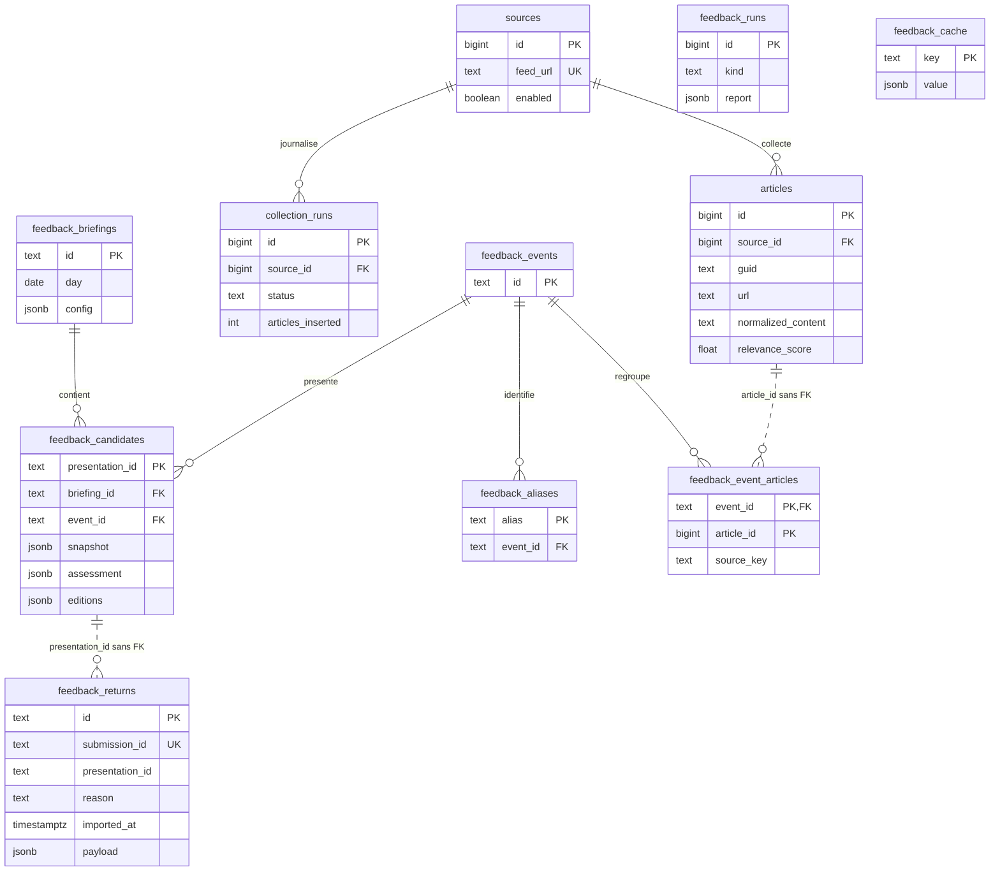

# AI News

Veille RSS/Atom sur l’IA, l’IT, la cybersécurité et les risques, avec un contexte métier de casino physique au Luxembourg. Le projet produit un briefing français, un MP3 et, en option, un podcast publié par SFTP.


La documentation du projet est centralisée dans ce README : fonctionnement,
commandes, tests, limites, cadrage historique et consignes de travail. Ne pas
créer d’autre fichier Markdown de documentation ni de dossier `docs/`.

Accès directs : [rétropublication](#retropublication),
[notation globale](#notation-newsletter), [cadrage historique](#cadrage-historique),
[consignes de travail](#consignes-projet).

## Flux de traitement

```text
config.yaml : collection.sources
  → Collecte RSS/Atom et normalisation HTML
  → PostgreSQL : articles et historique de collecte
  → Scoring par mots-clés, fraîcheur, longueur et bonus métier
  → Vue unique_articles : une ligne par GUID
  → Briefing : filtres, watchlists, détection CVE/CVSS
  → MiniLM : classification et regroupement des événements
  → Qwen via Ollama : déduplication complémentaire, évaluation et sélection
  → Qwen : titres et résumés anglais
  → MarianMT + glossaire : traduction française
  → output/briefing.md
  → Mail HTML + texte via SMTP (optionnel)
  → Kokoro : output/AAAA-MM-JJ-briefing.mp3
  → SFTP : MP3, illustration et podcast.xml
```

La collecte et le scoring écrivent en base. Le briefing lit la base et écrit le Markdown ; ses évaluations Qwen ne sont pas conservées en base. Les modèles fonctionnent localement après téléchargement initial. Les priorités P1/P2 sont des signaux textuels provisoires, à vérifier dans les sources.

Le regroupement du briefing est autonome. `embeddings.worker` est un outil de diagnostic qui affiche des similarités ; il ne calcule aucun score et ne stocke aucun groupe.

## Installation

Toutes les commandes partent de la racine du dépôt. Docker et Docker Compose avec profils sont nécessaires ; ajouter `sudo` devant `docker` si votre compte l’exige.

### Initialisation automatique (recommandée)

Installer Docker avec le plugin Compose v2 et `curl`, puis depuis le dépôt cloné :

```bash
./init-repo.sh
```

Le script crée `output/`, `podcast/state/`, `audio/voices/` et les dossiers de modèles. Si `.env` est absent, il le crée avec un mot de passe PostgreSQL aléatoire. Il télécharge Kokoro et les voix FR/EN, construit les images (mailer inclus), démarre PostgreSQL et Ollama, applique les scripts SQL et télécharge Qwen, MiniLM et MarianMT. MiniLM et MarianMT sont conservés dans le volume `embeddings_models`, Qwen dans `ollama_models`.

Internet et plusieurs Go de disque sont nécessaires. Le script s’arrête à la première erreur et peut être relancé : les modèles audio non vides déjà présents et le `.env` existant sont conservés. Ne pas changer le mot de passe d’un PostgreSQL déjà initialisé en modifiant seulement `.env`.

```bash
# Télécharger seulement Kokoro, sans Docker ni initialisation SQL
./init-repo.sh --models-only
# Initialisation complète avec les voix Piper FR/EN configurées
./init-repo.sh --with-piper
# Télécharger seulement Kokoro et Piper
./init-repo.sh --models-only --with-piper
```

Sources : [Kokoro-82M](https://huggingface.co/hexgrad/Kokoro-82M/tree/main) et [Piper voices](https://huggingface.co/rhasspy/piper-voices/tree/main). Le script contient les commandes `curl` de téléchargement. Ajouter manuellement toute voix personnalisée et adapter `config.yaml`.

Aucune collecte, aucun mail et aucune publication ne sont lancés. Compléter les configurations SMTP/SFTP et `.env` avant le pipeline quotidien. Le fichier `podcast/known_hosts` est créé vide : ajouter la clé vérifiée du serveur avant publication. Pour utiliser un fichier existant, définir `PODCAST_KNOWN_HOSTS=/chemin/absolu/known_hosts` dans `.env`.

XTTS reste optionnel : construire le service dédié et lancer la commande décrite plus bas pour télécharger son modèle. Fournir aussi `audio/voices/homme_fr.wav` ; aucune voix de référence n’est générée par le script.

Les étapes suivantes détaillent l’installation manuelle.

### 1. Préparer la configuration

```bash
cd /opt/ai-news
mkdir -p output podcast/state
# Créer ou compléter .env avec votre éditeur.
```

Variables attendues dans `.env` (remplacer les exemples) :

```dotenv
POSTGRES_DB=ai_news
POSTGRES_USER=ai_news
POSTGRES_PASSWORD=mot_de_passe_a_remplacer
POSTGRES_PORT=5432
# Seulement pour la publication SFTP :
PODCAST_SFTP_USER=utilisateur_sftp
PODCAST_SFTP_PASSWORD=mot_de_passe_sftp
```

### 2. Construire et démarrer les services

```bash
docker compose --profile ai config --quiet
docker compose --profile ai build collector embeddings audio podcast
docker compose --profile ai up -d --wait postgres ollama
docker compose exec ollama ollama pull qwen2.5:3b
```

PostgreSQL et Ollama restent démarrés. Les autres services s’exécutent à la demande. Le profil `xtts` est une alternative audio distincte. Les limites mémoire des conteneurs s’additionnent : 6 Go pour `embeddings`, 4 Go pour Ollama, 2 Go pour `audio` ; surveiller la mémoire sur une machine de 8 Go.

### 3. Initialiser le schéma SQL

Compose ne monte pas de scripts d’initialisation PostgreSQL. Sur une base neuve, appliquer les six fichiers dans l’ordre :

```bash
for sql in app/sql/001_initial_schema.sql \
           app/sql/002_normalized_content.sql \
           app/sql/003_article_scoring.sql \
           app/sql/004_unique_articles.sql \
           app/sql/005_feedback.sql \
           app/sql/006_newsletter_feedback.sql; do
  docker compose exec -T postgres sh -c \
    'psql -v ON_ERROR_STOP=1 -U "$POSTGRES_USER" -d "$POSTGRES_DB"' < "$sql" || break
done
```

Vérifier que chaque fichier s’est terminé sans erreur avant de poursuivre. Les scripts actuels utilisent `IF NOT EXISTS` ou `CREATE OR REPLACE VIEW`.

## Exécution étape par étape

### 1. Collecter et normaliser

```bash
docker compose run --rm -T collector
```

Le collecteur parcourt les sources activées, insère les nouveaux articles, puis normalise le HTML. Un article existant de même source et même GUID n’est pas mis à jour. Les erreurs de flux sont enregistrées dans `collection_runs` et les autres flux continuent.

**Comportement actuel : une source avec `enabled: false` entraîne la suppression de ses articles en base au début de la collecte.**

Le catalogue et les autres configurations du collecteur sont montés depuis l’hôte. Une modification de `config.yaml` est prise en compte à la prochaine collecte. Après modification du code ou des dépendances, reconstruire :

```bash
docker compose build collector
```

### Désactivation automatique des flux défaillants

La section `collection` de `config.yaml` contient la politique :

```yaml
collection:
  source_health:
    auto_disable: true
    consecutive_failures: 3
```

Après trois échecs consécutifs de téléchargement ou de lecture d’un flux, la source passe à `enabled: false` dans le YAML et en base. Ses articles sont supprimés de la base ; la source et son historique `collection_runs` sont conservés. Une collecte réussie, même partielle, interrompt la série d’échecs. Un flux valide sans article n’est pas une erreur. Les erreurs SQL/internes ne comptent pas pour la désactivation automatique.

Le fichier YAML est modifié sous verrou et remplacé atomiquement ; sa version précédente est conservée dans `config.yaml.bak`. Les sources suivantes continuent d’être collectées. Les modifications restent visibles dans Git pour revue. Si l’écriture du YAML échoue, la source n’est pas automatiquement purgée en base.

Pour réactiver une source après correction de son URL ou résolution du problème, remettre `enabled: true` dans le YAML : la prochaine collecte la réactive en base. Les articles seront récupérés à nouveau selon le contenu disponible du flux. Définir `auto_disable: false` pour conserver uniquement l’enregistrement des erreurs.

Après cette mise à jour, reconstruire le collecteur : `sudo docker compose build collector`. Les compteurs utilisent les erreurs de flux identifiées par cette version ; les anciennes erreurs non catégorisées ne déclenchent pas de désactivation immédiate.

### 2. Calculer les scores

```bash
docker compose run --rm -T collector python -m app.scorer
```

Le score combine `scoring.topics` et le bonus métier de `briefing.scoring` dans `config.yaml`. Il est utilisé pour filtrer les candidats du briefing. `briefing.scoring.rescore_all: true` recalcule toute la base ; sinon les scores absents ou anciens de plus de 12 heures sont traités.

Pour reprendre uniquement une normalisation incomplète :

```bash
docker compose run --rm -T collector python -m app.normalize_articles
```

### 3. Vérifier la sélection sans générer le briefing

```bash
docker compose --profile ai run --rm -T \
  -e BRIEFING_DRY_RUN=1 embeddings python -m embeddings.briefing
```

Ce contrôle charge MiniLM et appelle Qwen pour la déduplication et l’évaluation. Il ne fait ni synthèse, ni traduction, ni écriture du Markdown.

### 4. Générer le briefing

```bash
docker compose --profile ai run --rm -T \
  -e BRIEFING_DRY_RUN=0 \
  -e BRIEFING_OUTPUT=/output/briefing.md \
  embeddings python -m embeddings.briefing
cat output/briefing.md
```

Le montage `./output:/output` conserve le résultat après suppression du conteneur. Sans `BRIEFING_OUTPUT`, le chemin par défaut est `/tmp/ai-news-briefing.md`, non persistant.

Le briefing filtre les articles récents selon le score et les règles de veille, puis regroupe les événements. Qwen évalue leur pertinence technique, leur importance et leur pertinence métier. La sélection applique les quotas thématiques et donne priorité aux P1 si l’option est activée. Les synthèses sont produites en anglais, puis traduites en français avec protection des termes techniques. Une annexe peut ajouter des liens vers des alertes P1/P2 évaluées mais non retenues. Le nombre publié peut être inférieur au plafond configuré.

### 5. Générer le MP3

Avec le moteur actuel `kokoro`, ces fichiers locaux sont nécessaires :

```text
audio/models/kokoro/config.json
audio/models/kokoro/kokoro-v1_0.pth
audio/models/kokoro/voices/ff_siwis.pt
```

Ils sont montés dans `/models`. Les modèles sont exclus de Git ; les télécharger avec `./init-repo.sh --models-only`. Le conteneur audio est configuré en mode Hugging Face hors ligne.

```bash
docker compose --profile ai run --rm -T audio
ls -lh "output/$(TZ=Europe/Paris date +%F)-briefing.mp3"
```

La section `audio` de `config.yaml` indique l’entrée Markdown, le moteur, la voix, les pauses et le débit. Le module préfixe automatiquement le nom de sortie par la date en Europe/Paris.

Le MP3 est mono, encodé à 22 050 Hz. Les paramètres se règlent dans le YAML : `pause_ms` entre articles, `title_pause_ms` après les titres et rubriques (0 à 10 000 ms), et `bitrate` parmi `24k`, `32k`, `40k`, `48k`. Vérifier à l’écoute les sigles, noms propres, CVE et anglicismes ; les pauses ne garantissent pas une prosodie particulière. Vérifier aussi les licences des modèles et voix utilisés.

Pour utiliser **Piper**, définir `audio.engine: piper` dans `config.yaml` et fournir le modèle ONNX ainsi que son fichier `.onnx.json` dans `audio/models/`. La voix française configurée est `/models/fr_FR-tom-medium.onnx`.

```bash
docker compose --profile ai build audio
docker compose --profile ai run --rm -T audio
```

Pour utiliser **XTTS**, définir `engine: xtts` et utiliser le service dédié, qui installe Coqui TTS. Le modèle nommé `tts_models/multilingual/multi-dataset/xtts_v2` utilise le cache `audio/models/xtts/` ; le premier lancement peut nécessiter un téléchargement. La référence vocale configurée est `audio/voices/homme_fr.wav`, montée dans `/voices/homme_fr.wav`.

```bash
docker compose --profile xtts build xtts
docker compose --profile xtts run --rm -T xtts
```

Repasser `engine: kokoro` pour le script quotidien, qui impose ce moteur. La génération audio produit le MP3 local ; la publication du RSS est réalisée à l’étape suivante.

### 6. Préparer et publier le podcast (optionnel)

Adapter la section `podcast` de `config.yaml` : métadonnées et rétention. Définir l’URL publique de base dans `.env` avec `PODCAST_SITE_URL` ; les éditions ajoutent automatiquement `/fr/` ou `/en/`. Fournir `podcast/cover.jpg` et les identifiants dans `.env`. La clé du serveur doit être vérifiée et présente dans le fichier `known_hosts` monté par Compose ; son chemin hôte par défaut est `./podcast/known_hosts`, configurable via `PODCAST_KNOWN_HOSTS` dans `.env`.

Utiliser une illustration JPEG carrée, idéalement 3 000 × 3 000 pixels en RGB. Vérifier `PODCAST_SFTP_REMOTE_PATH` depuis la session SFTP. L’adresse `PODCAST_EMAIL` apparaît publiquement dans le RSS : choisir une adresse de contact adaptée.

Pour récupérer la clé du serveur, `ssh-keyscan -p 22 ftp.cluster030.hosting.ovh.net` peut l’afficher ; vérifier son empreinte auprès d’une source de confiance avant de l’ajouter au fichier `known_hosts`.

Une clé SSH peut remplacer le mot de passe : la monter en lecture seule dans le service `podcast`, puis définir son chemin **dans le conteneur** via `.env` :

```dotenv
PODCAST_SFTP_KEY_FILE=/run/secrets/ovh_sftp_key
# Configuration SFTP et adresse publique du podcast :
PODCAST_SFTP_HOST=ftp.cluster030.hosting.ovh.net
PODCAST_SFTP_PORT=22
PODCAST_SFTP_REMOTE_PATH=/chemin/sftp/podcast
PODCAST_EMAIL=contact@example.com
PODCAST_SITE_URL=https://podcast.example.com/
```

Exemple de montage à ajouter aux volumes existants :

```yaml
      - /chemin/hote/cle_privee:/run/secrets/ovh_sftp_key:ro
```

`PODCAST_SFTP_PASSWORD` n’est pas nécessaire avec cette clé. Le programme de publication est `podcast/publish.py` ; son image est construite par `podcast/Dockerfile`.

Le montage `./podcast/state:/state` conserve l’historique RSS entre les exécutions. Chaque MP3 publié reçoit un nom unique `AAAA-MM-JJ-<empreinte SHA-256>-briefing.mp3`, utilisé aussi comme identifiant RSS. Plusieurs fichiers différents publiés le même jour ajoutent plusieurs épisodes ; republier le même fichier le même jour conserve une seule entrée et sa date initiale. Le fichier local reste `output/AAAA-MM-JJ-briefing.mp3`.

```bash
# Vérifie les fichiers et leur lecture, sans connexion SFTP.
docker compose --profile ai run --rm -T podcast --dry-run
# Publie le MP3, l’illustration et le RSS sur le serveur configuré.
docker compose --profile ai run --rm -T podcast
```

Après publication, vérifier le RSS à l’adresse configurée, <https://podcast.chauchard.info/fr/podcast.xml> pour le français et <https://podcast.chauchard.info/en/podcast.xml> pour l’anglais, ainsi que les liens MP3. La description des épisodes reprend les titres et les sources du Markdown (`**Sources :**`, `Sources:` ou listes de liens après un bloc sources). Si le format du briefing change, vérifier son interprétation avec `--dry-run`.

Le contrôle à blanc nécessite déjà le MP3 daté, le Markdown et l’illustration. La publication transfère d’abord le MP3 et l’illustration, puis remplace atomiquement le RSS avant de supprimer les MP3 distants expirés (7 jours calendaires actuellement). Seuls les MP3 de briefing expirés portant le nom daté historique ou le nouveau nom avec empreinte sont supprimés. Conserver `podcast/state/episodes.json` : les anciens épisodes ne sont pas reconstruits depuis le serveur. Si cet historique a déjà été perdu, cette correction conserve les nouveaux épisodes mais ne restaure pas les précédents.

### 7. Envoyer le briefing par mail (optionnel)

Le service `mailer` transforme `output/briefing.md` en mail HTML avec titres, listes, tableaux et liens sources. Il joint aussi une version texte dans le même message. L’envoi est indépendant de l’audio et du podcast.

Modifier la section `mail` de `config.yaml` (extrait) :

```yaml
input: /output/briefing.md
subject: "AI News — Briefing du {date}"
smtp:
  host: smtp.example.com
  port: 587
  security: starttls
  auth: true
  timeout: 30
```

`{date}` est remplacé par la date en Europe/Paris. Choisir `starttls` pour une connexion mise à niveau TLS (généralement port 587), ou `ssl` pour TLS dès la connexion (généralement port 465). La vérification du certificat est activée. `none` est réservé à un relais sans authentification (`auth: false`). L’expéditeur doit être autorisé par votre serveur SMTP.

Renseigner les variables dans `.env` :

```dotenv
SENDER="AI News <ai-news@example.com>"
RECIPIENT=destinataire@example.com
SMTP_USERNAME=identifiant_smtp
SMTP_PASSWORD=mot_de_passe_smtp
```

Compose transmet `SENDER`, `RECIPIENT`, `SMTP_USERNAME` et `SMTP_PASSWORD` au service mail. `SENDER` et `RECIPIENT` ont priorité sur les anciennes valeurs YAML. Le module lancé directement en Python attend ces variables dans son environnement ; il ne charge pas `.env` lui-même.

```bash
docker compose --profile mail build mailer
# Génère output/briefing-email.html sans connexion SMTP ni envoi.
docker compose --profile mail run --rm -T mailer --dry-run
# Envoie le briefing au destinataire configuré.
docker compose --profile mail run --rm -T mailer
```

L’aperçu ne nécessite pas d’identifiants SMTP. Chaque commande mail manuelle sans `--dry-run` envoie un nouveau mail ; le pipeline quotidien mémorise les étapes terminées. Le script `run-daily.sh` envoie le mail après la génération et la vérification du Markdown, avant les étapes audio et podcast. Un échec d’envoi arrête le pipeline. Construire l’image `mailer` et renseigner la configuration SMTP avant le prochain lancement quotidien.

## Éditions anglaise puis française

`briefing.languages: [en, fr]` active la génération des deux éditions. Les sources FR et EN restent collectées ensemble. Le regroupement utilise MiniLM multilingue ; Qwen synthétise une seule fois en anglais, puis MarianMT traduit les mêmes événements en français. Les liens et titres des sources restent dans leur langue d’origine. Une erreur de traduction arrête la génération plutôt que de publier une sélection française incomplète.

Le pipeline quotidien regroupe les résultats dans cette arborescence :

```text
output/daily/2026-10-11/
├── generated
├── en/
│   ├── briefing.md
│   ├── briefing-email.html
│   ├── 2026-10-11-briefing.mp3
│   ├── podcast.xml
│   ├── mail.done
│   ├── audio.done
│   └── podcast.done
└── fr/
    └── mêmes fichiers
```

Le pipeline traite mail, audio et publication anglais avant les étapes françaises. Les deux Markdown sont préparés avant les envois. Les marqueurs `.done` servent à reprendre une exécution interrompue. Le mail HTML est conservé aussi lors d’un envoi réel. Le XML local est le flux préparé pour la publication, pas un accusé de transfert.

```bash
DAY=$(TZ=Europe/Paris date +%F)
# Générer les deux Markdown sans envoi
docker compose --profile ai run --rm -T -e BRIEFING_DAILY_DIR="/output/daily/$DAY" embeddings python -m embeddings.briefing
# Aperçu du mail anglais : daily/AAAA-MM-JJ/en/briefing-email.html
docker compose --profile mail run --rm -T mailer --language en --input "/output/daily/$DAY/en/briefing.md" --dry-run
# Générer l’audio anglais
docker compose --profile ai run --rm -T audio --config /config.yaml --language en --input "/output/daily/$DAY/en/briefing.md" --output "/output/daily/$DAY/en/briefing.mp3" --date "$DAY"
# Vérifier la publication anglaise sans transfert
docker compose --profile ai run --rm -T podcast --language en --date "$DAY" --dry-run
```

Reconstruire les images après cette mise à jour :

```bash
docker compose --profile ai --profile mail build collector embeddings audio podcast mailer
```

La section `mail` permet de surcharger `subject` dans `editions.en` et `editions.fr`. Les deux éditions utilisent `SENDER` et `RECIPIENT` définis dans `.env`. La section `audio` fournit les voix EN/FR. Dans la section `podcast`, `editions.en` définit le flux anglais sous `/en/`, son sous-répertoire SFTP `en` et `/state/episodes-en.json`. Le français utilise `/fr/`, le sous-répertoire SFTP `fr` et `/state/episodes-fr.json`. Le chemin distant de base vient de `PODCAST_SFTP_REMOTE_PATH` dans `.env` ; chaque édition ajoute `/fr` ou `/en`. Définir `PODCAST_SITE_URL` dans `.env` sans suffixe de langue ; les URL des éditions sont construites automatiquement en conservant un éventuel chemin de base.

Chaque flux RSS contient les épisodes de sa langue : le flux français est à `/fr/podcast.xml` et le flux anglais à `/en/podcast.xml`. Le nouveau flux français démarre avec un historique distinct ; les anciens épisodes et le flux à la racine ne sont pas déplacés automatiquement. Les titres d’épisodes portent `[FR]` ou `[EN]` et sont localisés. La description utilise des sauts de ligne HTML (`<br/>`) pour les lecteurs RSS, avec une version texte multiligne dans `itunes:summary`. Les titres et noms des sources sont conservés dans leur langue d’origine.

Les étapes terminées sont mémorisées dans `output/daily/AAAA-MM-JJ/`, avec les deux Markdown. Relancer le service le même jour reprend les étapes restantes et conserve la sélection. Ne pas supprimer ces fichiers pour une simple reprise. Pour régénérer volontairement toute la journée, retirer ce dossier avant de relancer : les mails seront renvoyés. Une interruption entre l’acceptation SMTP et l’écriture du marqueur peut aussi entraîner un doublon ; SMTP ne garantit pas un envoi exactement une fois.

La date audio/podcast est fixée au début du pipeline, même si l’exécution dépasse minuit. Les dossiers quotidiens ne sont pas purgés automatiquement. Au prochain lancement, les anciens Markdown, MP3 et marqueurs de la journée présents dans `output/.daily/` ou à la racine de `output/` sont copiés vers la nouvelle structure sans supprimer les originaux. Les mails déjà envoyés ne sont pas renvoyés. Pour revenir à une génération Markdown unique, supprimer `languages` et conserver `language: fr` ; le pipeline quotidien, lui, attend les deux éditions.

### Éviter les répétitions entre les jours

Avant la sélection, le briefing lit les `briefing.md` des sept jours précédents dans `output/daily/AAAA-MM-JJ/en/` ou, à défaut, `fr/`. Il ne compare pas les deux éditions d’une même journée, ni celle du jour en cours. Aucun historique JSON supplémentaire n’est créé. Sans briefing antérieur, aucun contrôle n’est effectué.

Les événements dont toutes les URL sources ont déjà été utilisées sont exclus. Pour les nouvelles sources ou reformulations FR/EN, MiniLM repère les événements proches ; Qwen confirme s’il s’agit du même événement sans information nouvelle. Une évolution substantielle est conservée, et un thème commun ne suffit pas à exclure un sujet. La détection sémantique reste probabiliste.

La configuration `briefing.briefing.history.days` règle la fenêtre (7 par défaut, 0 pour désactiver) et `similarity_threshold` le seuil de présélection sémantique (0.72). Le modèle MiniLM est partagé avec le regroupement pour éviter un deuxième chargement. Les exclusions sont consignées dans les logs. Les fichiers existants ne sont pas modifiés. Une erreur de lecture ou d’évaluation arrête la génération plutôt que d’ignorer silencieusement le contrôle.

## Votes et apprentissage personnalisé

**État actuel : les boutons du mail sont rétablis ; les données et leur schéma
sont conservés, mais la collecte locale et la personnalisation restent absentes.** Lors de la centralisation de la
configuration, la version V2 sans les modules `feedback/` et `web/` a été retenue.
Le pipeline actuel ne collecte donc pas les votes et n’apprend pas à partir d’eux.
Reconstruire les images ne rétablit pas cette fonction.

### Boutons du mail rétablis le 13 octobre 2026

Le mailer ajoute six boutons signés sous chaque news principale, en HTML et en
texte, si `FEEDBACK_URL` et `FEEDBACK_SIGNING_SECRET` sont transmis depuis `.env`.
Le secret existant doit correspondre au PHP distant (au moins 32 octets) : ne pas
le remplacer. Le protocole signé V1 reprend celui de la branche V3 historique.
Reconstruire uniquement `docker compose --profile mail build mailer`, puis vérifier
avec `mailer --dry-run` via Compose avant le prochain envoi autorisé.
Aucun envoi ni déploiement distant n’a été effectué pour cette restauration.

Les anciens marqueurs sont respectés. Sans marqueur, l’identité est calculée
à partir des URL sources triées et de la date inscrite dans le briefing : mêmes
sources et même jour donnent la même présentation EN/FR, indépendamment du titre.
Cette identité ne fusionne pas des événements aux sources différentes ; elle ne
rétablit pas la traçabilité PostgreSQL des nouveaux candidats ni leur import.
Les Markdown figés, annexes, marqueurs de reprise et votes existants sont préservés.
Le rendu ne fait aucun accès réseau, SQL ou modèle ; il utilise uniquement la
bibliothèque standard et les dépendances déjà présentes du mailer.

Réglages facultatifs dans la section `mail` du `config.yaml` principal :
`feedback: {enabled: false, link_days: 90}` pour désactiver les boutons ; sans ce
bloc, ils sont actifs lorsque l’URL est renseignée. L’expiration dépend du jour du
briefing : minuit Europe/Paris plus exactement 90 × 86 400 secondes par défaut.
Les éditions futures ou expirées sont refusées. En mode GET direct, `link_days`
doit correspondre à `link_seconds / 86400` dans le privé PHP (90 jours par défaut).
Le fichier actuel appartenant à root, aucun réglage n’y a été ajouté lors de ce
correctif. Une configuration incomplète avec URL renseignée interrompt le rendu.
Retour arrière : retirer `FEEDBACK_URL` de l’environnement mailer ou désactiver
`mail.feedback.enabled`, sans effacer de données ni de marqueurs.
Le mode de confirmation reste celui du PHP distant : GET sans vote par défaut ;
l’essai `require_confirmation=false` peut recevoir des votes de scanners mail.
Vérifications locales : 47 tests réussis (dont 13 tests mail), validation Compose
`config --quiet` réussie ; aucune inférence réelle ni envoi SMTP. La disponibilité
du récepteur distant et l’enregistrement réel des nouveaux votes n’ont pas été
vérifiés dans cette intervention.

### Correction de la date des liens — 13 octobre 2026

Le PHP historique en mode vote GET direct calcule la date de soumission avec
`exp - link_seconds`. Le calcul initial du mailer ajoutait un jour et utilisait
une durée calendaire : la date ainsi reconstruite pouvait être future, provoquant
« Date de lien invalide ». Le mailer utilise désormais une durée exacte depuis
minuit du jour du briefing à Paris, sans jour supplémentaire ni décalage lié au
changement d’heure. Les identifiants de présentation, secrets et votes conservés
ne changent pas. Le rendu reste local, sans accès réseau supplémentaire.

Reconstruire le mailer et renvoyer explicitement les éditions depuis leurs
Markdown existants pour obtenir de nouveaux liens ; les anciens mails restent
inchangés. Aucun renvoi automatique ni modification du PHP distant n’est effectué.
Pour suspendre les boutons : `mail.feedback.enabled: false` dans `config.yaml`.
Tests : contrôle de la date déduite par le PHP sur trois dates, dont les passages
heure d’été/hiver, et refus des briefings futurs. Le binaire PHP local étant absent,
ce contrôle reproduit son calcul ; il ne valide pas le récepteur distant.

Diagnostic complémentaire du 13 octobre : les aperçus
`output/feedback-test-2026-10-13-{en,fr}.html` contiennent chacun 84 liens dont
la date déduite vaut bien le 13 octobre à 00:00 à Paris **si** le PHP utilise
`link_seconds = 7776000` (90 jours). Les 15 tests mail passent dans
`/tmp/ai-news-tests-venv`. Une erreur persistante exige de vérifier le fichier
effectivement ouvert et cette durée côté PHP ; le récepteur distant n’a pas été
consulté et aucun lien GET n’a été suivi, car il pourrait enregistrer un vote.

### Le flux prévu et testé précédemment

Récupération manuelle du 13 octobre 2026 : l’importeur `feedback/importer.py`
a récupéré et stocké 13 nouveaux retours dans PostgreSQL via son port local
publié, puis confirmé ces 13 identifiants au PHP pour leur purge distante.
Aucun retour invalide, conflit ni erreur de confirmation signalé. Les votes
effectifs après import sont au nombre de 24 ; les clics du mode GET peuvent
provenir de scanners et ne constituent pas tous des annotations humaines.
Cette récupération ponctuelle ne réactive pas l’import quotidien automatique.
Les secrets sont chargés depuis `.env` sans affichage. Aucun mail, modèle,
marqueur quotidien ni briefing n’a été modifié. L’import conserve l’historique :
aucune suppression locale n’est nécessaire pour revenir au pipeline habituel.

```text
Bouton sous une news dans le mail
  → PHP public : réception du motif signé
  → un fichier JSON par retour, dans un dossier privé hors racine Web
  → serveur local : récupération avant une nouvelle sélection
  → stockage durable PostgreSQL, puis confirmation de l’import
  → serveur public : purge des seuls retours confirmés
  → analyse locale des votes et recherche d’exemples proches
  → proposition de sélection personnalisée pour les prochains briefings
  → entraînement supervisé séparé, évaluation puis activation explicite
```

Aucun commentaire n’est nécessaire. Les six motifs sont : **utile**, **hors de
mes sujets**, **pas applicable chez moi**, **trop superficiel / promotionnel**,
**pas assez nouveau** et **déjà traité**. L’absence de vote reste inconnue ;
« déjà traité » ne signifie pas que le thème est inutile. FR et EN partagent
l’identité de l’événement pour éviter de compter deux fois la même actualité.

### Ce que signifie « apprendre »

1. **Collecter et analyser** : conserver les votes, leurs corrections et le
   contenu des articles concernés. Collecter un vote ne modifie pas un modèle.
2. **Personnaliser avec quelques exemples** : MiniLM retrouve des événements
   annotés proches ; Qwen utilise ces exemples pour proposer une sélection.
   Un rejet ponctuel ne doit pas interdire tout un thème ou un fournisseur.
3. **Entraîner un modèle** : comparer une régression logistique locale à la
   référence, puis éventuellement CatBoost. Le seuil initial prévu était de
   100 événements distincts exploitables, dont 10 exemples par classe pour
   l’utilité. Un vote doit être relié à son article et à ses caractéristiques ;
   le nombre de clics seul ne suffit pas.

Tous les modèles et calculs restent locaux. L’entraînement ne se déclenche pas
à chaque clic et aucun modèle n’est promu automatiquement. La personnalisation
commence en **mode parallèle** : la sélection habituelle est envoyée, la proposition
personnalisée est enregistrée pour comparaison. L’activation vient après
évaluation chronologique, avec possibilité de retour à la référence. Les éditions
déjà générées restent figées.

### Résultats des essais et suite nécessaire

Les essais précédents ont vérifié l’envoi des mails, la réception PHP, le stockage
PostgreSQL et la purge publique. L’apprentissage lancé n’a produit aucun modèle :
les présentations de test restaient non rattachées et leurs caractéristiques
d’entraînement manquaient. Après nettoyage des artefacts de développement, les
correspondances des 14 présentations, les deux Markdown de test et les quatre
rapports sont archivés dans PostgreSQL : `feedback_runs`,
`kind = 'legacy_test_archive'`, `id = 3`, colonne JSONB `report`.
L’import depuis cette archive a ensuite créé 1 briefing, 14 événements,
14 présentations communes FR/EN, 14 liens vers les articles et 4 rapports séparés.
Les 13 votes sont maintenant rattachés, sans retour non résolu. Les textes publiés
sont dans `feedback_candidates.snapshot.published_editions` ; les rapports sont
dans `feedback_runs` avec `kind = 'legacy_test_report'`.
Les caractéristiques absentes ne sont pas inventées : `assessment` reste vide et
les instantanés sont marqués `retrospective` et `test_only`. Ils ne sont donc pas
encore prêts pour l’entraînement. L’import est transactionnel et idempotent :
sa seconde exécution n’a créé aucune donnée métier supplémentaire.
Les mails, scripts temporaires, paquets de déploiement et sauvegardes de migration
ont été supprimés ; les 30 fichiers de `output/daily/` sont inchangés.

Pour relancer cet import explicitement, avec `DATABASE_URL` fourni dans l’environnement :

```bash
python -m app.import_feedback_archive --archive-id 3
```

Pour reprendre la personnalisation, il faut réintégrer son service, adapter ses
réglages au `config.yaml` global, puis vérifier la boucle complète. La migration
`005_feedback.sql` conserve le schéma mais n’active aucun traitement automatique.
La configuration PHP privée et les JSON déployés
précédemment restent distincts du dépôt local ; leur état distant n’a pas été
revérifié pour cette mise à jour documentaire. Le mode testé sans confirmation
peut enregistrer des visites automatiques de Gmail : ces retours ne doivent pas
être considérés comme certainement humains.

## Modèle de données PostgreSQL

Schéma vérifié sur la base locale. Les traits pleins indiquent des clés
étrangères ; les pointillés indiquent des liens applicatifs sans contrainte FK.



`unique_articles` est une **vue** qui retient une ligne par GUID.
`feedback_effective_returns` est une **vue** qui retient le dernier retour par
présentation selon `(submitted_at, id)`. Aucun lien FK vers les présentations
n’est imposé aux retours, pour conserver un vote reçu avant son rattachement.
Les liens vers les articles n’ont pas de FK afin de survivre à leur purge.
Le couple `(briefing_id, event_id)` est unique ; les éditions FR/EN partagent
donc une présentation. `feedback_runs` conserve archives et rapports ;
`feedback_cache` est réservé aux résultats réutilisables des traitements.

## Configuration globale

Tous les réglages applicatifs sont réunis dans **`config.yaml` à la racine**,
avec des sections commentées. Les secrets, adresses mail et URL publiques restent
dans `.env`. `docker-compose.yml` décrit l’infrastructure, pas les choix éditoriaux.

| Section | Rôle |
|---|---|
| `collection` | Catalogue RSS/Atom et désactivation automatique des sources |
| `scoring` | Mots-clés et poids historiques |
| `briefing` | `briefing` : sélection EN/FR ; `llm` : Qwen ; `scoring` : bonus métier |
| `semantic_scoring` | Profils MiniLM et diagnostic |
| `watchlists` | Inclusion, exclusion et technologies suivies |
| `glossary` | Termes protégés et traduction |
| `audio` | Moteur, voix, pauses et MP3 |
| `podcast` | Métadonnées, éditions et rétention |
| `mail` | Objets par langue et paramètres SMTP |

Les valeurs antérieures ont été conservées : fenêtre de 24 h, score minimum 35,
15 événements maximum, 50 candidats Qwen et 8 arbitrages de déduplication.
Le contexte métier du prompt Qwen reste écrit dans `embeddings/briefing.py`.
La modification du YAML ne régénère aucune édition et n’envoie aucun mail.

**Après cette migration, reconstruire les images avant le prochain lancement :**

```bash
docker compose --profile ai --profile mail build collector embeddings audio podcast mailer
# Seulement si l’alternative XTTS est utilisée :
docker compose --profile xtts build xtts
# Vérification de la configuration Compose, sans afficher les secrets :
docker compose --profile ai --profile mail config --quiet
```

Le lancement quotidien vérifie la compatibilité des images avant tout traitement.
Les autres services lisent le fichier en lecture seule. Le collecteur monte le
répertoire du projet dans `/workspace` pour permettre le remplacement atomique
et la sauvegarde `config.yaml.bak` : ce conteneur a donc un accès en écriture au
dépôt. Les anciennes configurations restent récupérables dans l’historique Git ;
leurs copies temporaires de migration ont été supprimées après vérification.

Vérifications locales : 39 tests passent, syntaxe Python et shell valide,
configuration Compose valide et valeurs des neuf sections comparées à l’identique.
La reconstruction des images reste à effectuer : le socket Docker est inaccessible
dans cette session. Aucun pipeline complet, mail ou podcast lancé pour ces tests.

Pour une copie globale de test, passer `--config /chemin/config.yaml` aux commandes
mail/audio/podcast, ou `AI_NEWS_CONFIG=/chemin/config.yaml` en Python local.
Les anciens fichiers explicitement passés et variables par module restent lisibles
pour compatibilité, mais aucun fichier par module n’est fourni ni utilisé par défaut.
Pour revenir en arrière, restaurer ensemble le code et Compose de la version
précédente ainsi que ses YAML depuis Git, puis reconstruire ses images ; conserver
`.env`, les volumes, les podcasts et les marqueurs quotidiens.

## Installer le lancement quotidien comme service

Après `./init-repo.sh`, configurer et vérifier SMTP, SFTP et la clé du serveur : `run-daily.sh` envoie le mail et publie le podcast à chaque exécution. Sur une machine Linux avec systemd, Docker et cron :

```bash
# Debian/Ubuntu, si cron est absent
sudo apt install cron logrotate
# Déployer le service et la tâche quotidienne
sudo ./post-install.sh
```

Le script installe `/etc/systemd/system/ai-news.service`, `/etc/cron.d/ai-news` et `/etc/logrotate.d/ai-news`, recharge systemd et active le service cron. Il peut être relancé ; les fichiers remplacés sont sauvegardés à côté avec un suffixe `.bak.*`. Le chemin du dépôt est déduit de l’emplacement du script (par défaut `/opt/ai-news`). Relancer la post-installation si le dépôt est déplacé.

Le service est de type `oneshot`, exécuté en root, sans limite de durée, avec les sorties dans le journal systemd. Il démarre `run-daily.sh` depuis la racine du dépôt. Le cron contient :

```cron
0 4 * * * root /usr/bin/systemctl start --no-block ai-news.service
```

L’installation ne lance pas le pipeline immédiatement. Cron le déclenche chaque jour à **04:00 selon le fuseau du serveur** : vérifier avec `timedatectl`. Pour utiliser l’heure française, configurer le serveur avec `sudo timedatectl set-timezone Europe/Paris`. Le `TZ=Europe/Paris` du pipeline règle ses dates, pas l’heure de déclenchement du cron.

```bash
# Déclencher une exécution manuelle (mail et publication inclus)
sudo systemctl start --no-block ai-news.service
# Consulter l’état et suivre les journaux
sudo systemctl status ai-news.service
sudo journalctl -u ai-news.service -f
# Consulter les fichiers installés
systemctl cat ai-news.service
cat /etc/cron.d/ai-news
```

Après une exécution réussie, un service `oneshot` revient normalement à l’état `inactive (dead)`. Consulter le résultat avec `systemctl show ai-news.service -p Result -p ExecMainStatus`. Systemd ne démarre pas une deuxième instance tant que la première est active ; le verrou du pipeline protège aussi les lancements directs.

Le pipeline écrit toutes ses sorties standard et erreurs (commandes Docker incluses) dans `/var/log/ai-news.log`, tout en les conservant dans le journal systemd. Les lancements directs de `run-daily.sh` utilisent aussi ce fichier. Le journal est réservé à root (mode `0640`). Les logs internes des services persistants PostgreSQL/Ollama restent accessibles avec `docker compose logs`.

Logrotate effectue une rotation quotidienne avec sept archives et suppression des archives de plus de sept jours. Les archives sont compressées à partir de la deuxième rotation. `copytruncate` permet à une exécution en cours de continuer à écrire ; une très courte fenêtre de perte est possible pendant la copie/troncature. La rotation est exécutée par `logrotate.timer` ou le cron quotidien de la distribution.

```bash
# Déployer ou mettre à jour la journalisation et sa rotation
sudo ./post-install.sh
sudo tail -f /var/log/ai-news.log
# Vérifier la configuration sans effectuer de rotation
sudo logrotate --debug /etc/logrotate.d/ai-news
```

Pour retirer la planification (sans interrompre une exécution en cours) :

```bash
sudo rm -f /etc/cron.d/ai-news
sudo rm -f /etc/systemd/system/ai-news.service
sudo systemctl daemon-reload
```

### Dépendances et téléchargements pendant l’exécution

Les paquets pip sont installés à la construction des images. L’image audio inclut aussi `en_core_web_sm`, utilisé par Misaki pour l’anglais : sans ce modèle, Misaki déclenche automatiquement son installation au lancement du conteneur, qui serait répétée avec `run --rm`. Les dépendances audio sont regroupées dans `audio/requirements.txt`. `sacremoses` est inclus dans les dépendances du briefing pour MarianMT.

Après une modification de ces dépendances :

```bash
docker compose --profile ai build audio embeddings
```

Les téléchargements pip pendant cette construction sont normaux. Les poids Kokoro sont fournis par `init-repo.sh`, et les modèles du briefing sont conservés dans le volume `embeddings_models`.

## Diagnostic et automatisation

```bash
# État et journaux des services persistants
docker compose --profile ai ps
docker compose logs --tail=100 postgres ollama
docker stats --no-stream

# Analyse facultative des similarités (aucune écriture en base)
docker compose --profile ai run --rm -T embeddings python -m embeddings.worker

# Statut des collectes
docker compose exec -T postgres sh -c \
  'psql -U "$POSTGRES_USER" -d "$POSTGRES_DB" -c "SELECT status, COUNT(*) FROM collection_runs GROUP BY status;"'
```

`run-daily.sh` enchaîne infrastructure, collecte, diagnostic MiniLM, briefing, envoi du mail, audio et publication. Le scoring `app.scorer` est exécuté après la collecte. Son verrou `/run/ai-news.lock` exige les permissions adaptées. Le script `post-install.sh` installe la planification décrite ci-dessous.

Autres limites à garder en tête : les articles sans date de publication sont exclus du briefing ; la vue SQL déduplique uniquement par GUID ; les évaluations Qwen sont répétées à chaque exécution. Les résumés et priorités produits par les modèles demandent une vérification des sources avant une décision opérationnelle.

Documentation vérifiée par lecture du code. L’exécution complète PostgreSQL/Ollama/traduction/audio/SFTP n’a pas été relancée pour cette revue.

<a id="retropublication"></a>

## Éditions rétrospectives

`run-daily.sh --date AAAA-MM-JJ` prépare une édition passée à partir des articles
actuellement disponibles et scorés en base. La sélection couvre la journée civile
Europe/Paris, borne initiale incluse, minuit suivant exclu (23/25 heures lors des
changements d’heure). Elle utilise `published_at`, sans exclure les articles
collectés après cette journée. Les dates absentes restent exclues ; une date RSS
incorrecte reste une limite de la source. Le contenu, les scores, les modèles et
la configuration sont ceux disponibles aujourd’hui, pas un instantané historique.

La collecte et le scoring ne sont pas relancés en mode rétrospectif. La base doit
avoir été alimentée auparavant. Le filtre historique lit uniquement les éditions
antérieures à la date demandée. Préparer plusieurs jours dans l’ordre chronologique.
Les éditions ultérieures déjà figées ne sont pas réécrites et peuvent partager un
événement avec une édition ajoutée après coup.

### Commandes

Reconstruire les images concernées :

```bash
docker compose --profile ai --profile mail build embeddings audio podcast mailer
```

Préparer les deux langues : modèles locaux, Markdown, aperçus HTML et MP3, sans
SMTP ni SFTP. Le script utilise son verrou et son journal habituels et peut donc
nécessiter les droits d’exploitation déjà utilisés pour le lancement quotidien.

```bash
sudo ./run-daily.sh --date 2026-10-12
```

Résultats : `output/daily/2026-10-12/{en,fr}/`. La génération porte sa date d’édition
et la mention rétrospective. `generated` et `audio.done` permettent la reprise ;
les aperçus n’inscrivent pas `mail.done` ni `podcast.done`. Des Markdown présents
sans `generated` provoquent un arrêt : vérifier les deux éditions avant de rétablir
ce marqueur, sans supprimer les fichiers pour contourner le contrôle.

Vérifier le RSS local, sans transfert (écrit `podcast.xml`) :

```bash
docker compose --profile ai run --rm -T podcast --language fr --date 2026-10-12 --dry-run
docker compose --profile ai run --rm -T podcast --language en --date 2026-10-12 --dry-run
```

Publier explicitement les deux podcasts, sans envoi de mail :

```bash
sudo ./run-daily.sh --date 2026-10-12 --publish
```

Ajouter `--send-mail` pour envoyer aussi les mails. Chaque étape externe respecte
son marqueur existant. Sans `--date`, le pipeline conserve son fonctionnement
quotidien ; `--prepare` permet de préparer le jour courant sans envoi ni transfert.

Le podcast distingue la date d’édition (titre et nom MP3) de la date réelle de
publication (`pubDate`). La rétention reste basée sur la journée réelle et la date
d’édition : publication refusée si l’édition est hors fenêtre, sept jours par défaut.
Une édition plus ancienne peut être générée localement. La republier avec le même
MP3 et la même date ne crée pas un nouvel épisode et conserve sa date de publication.
Les liens de feedback suivent la date d’édition et leur expiration habituelle ;
une édition très ancienne peut donc avoir des liens expirés.

### Tests et limites de validation

Tests sans modèles, SMTP, SFTP ni base réelle :

```bash
python3 -m venv /tmp/ai-news-retro-tests
/tmp/ai-news-retro-tests/bin/pip install numpy PyYAML ruamel.yaml 'psycopg[binary]' paramiko Markdown bleach
/tmp/ai-news-retro-tests/bin/python -m unittest discover -s tests -v
bash -n run-daily.sh
git diff --check
```

Validation locale effectuée : 55 tests réussis, syntaxe Bash, compilation Python,
`git diff --check` et `docker compose --profile ai --profile mail config --quiet`.
Le test du script utilise Docker simulé dans un dossier temporaire ; il vérifie
préparation, reprise et effets externes explicitement demandés.

Les tests couvrent les fenêtres SQL historiques et actuelles, les passages
été/hiver, l’objet mail, la rétention et la reprise RSS, ainsi que les tests
existants. Ils ne valident pas une synthèse réelle, la qualité éditoriale ou une
publication distante. Une préparation locale appelle les modèles et consomme
CPU/RAM ; ce n’est pas un test unitaire.

### Retour arrière

Conserver une copie des fichiers modifiés avant déploiement et des historiques
`podcast/state/episodes-*.json` avant toute publication réelle. Restaurer le code
précédent et reconstruire les images concernées pour revenir au fonctionnement
antérieur. Préserver les dossiers quotidiens, marqueurs et volumes. Un mail envoyé
ne peut pas être rappelé ; restaurer un état local RSS ne restaure pas le serveur
distant et nécessite une opération de publication distincte.


<a id="notation-newsletter"></a>

## Appréciation de l’équilibre quotidien

Trois boutons en fin de mail : **Équilibrée**, **Trop cyber**, **Trop IA**.
L’édition anglaise affiche les mêmes choix traduits. Aucun commentaire requis.
Les six motifs sous chaque article restent inchangés.

### Contrat et conservation

L’identité globale est le SHA-256 du JSON canonique
`{"briefing_date":"AAAA-MM-JJ","scope":"newsletter-feedback-v1"}`.
Elle est commune EN/FR ; une correction remplace le choix effectif de cette journée,
avec conservation de toutes les soumissions. L’absence de réponse reste inconnue.
Le vote « trop cyber » ne signifie pas que chacun des articles cyber est inutile.
Aucun changement automatique de sélection ou entraînement n’est introduit.

Les motifs sont `newsletter_balanced`, `newsletter_too_cyber`, `newsletter_too_ai`.
Le protocole signé V1 ajoute `briefing_date` uniquement pour ces motifs : les
anciens payloads d’article et leurs signatures sont inchangés. Une date qui ne
correspond pas à l’identité est refusée. Le PHP limite la page de correction aux
trois choix globaux, ou aux six motifs d’article selon le lien ouvert.

Les JSON publics individuels, temporaires et privés, utilisent la même file
pull/ack. L’importeur stocke les votes globaux dans `feedback_newsletter_returns`,
les votes d’article dans `feedback_returns`. Une transaction est validée avant
confirmation des identifiants ; répétitions connues acceptées sans doublon,
conflits non confirmés. `feedback_effective_newsletter_returns` expose le dernier
choix par identité, ordonné par date de soumission puis identifiant. Le mode POST
permet une correction chronologique ; en mode GET direct, plusieurs motifs de la
même journée ont une date de lien identique et leur ordre de clic n’est pas connu.
Le lien « Modifier mon choix » passe par une nouvelle confirmation POST.

GET demande confirmation par défaut. L’option privée historique
`require_confirmation=false` conserve le mode GET direct expérimental : les
scanners mail peuvent alors voter. Les secrets et la configuration privée restent
hors racine Web. L’expiration suit `mail.feedback.link_days` (90 jours par défaut),
qui doit correspondre à `link_seconds` du PHP pour le mode direct.

### Activation

Le récepteur de référence est `web/public/feedback.php` de la branche GitHub
`main`, récupéré sans fusion ni changement de branche. Il est identique au
récepteur historique avant cette extension.

L’activation est distincte de la préparation du code ; aucun déploiement effectué.
Le fichier global actuellement détenu par root n’a pas été modifié.

1. Sauvegarder le PHP actuellement déployé, son chemin de configuration privée et
   la base locale. Ne pas remplacer les secrets existants par ceux d’un exemple.
2. Appliquer la migration additive, sans toucher aux tables d’article :

```bash
docker compose exec -T postgres sh -c \
  'psql -v ON_ERROR_STOP=1 -U "$POSTGRES_USER" -d "$POSTGRES_DB"' \
  < app/sql/006_newsletter_feedback.sql
```

3. Mettre à jour le récepteur avec `web/public/feedback.php`, en conservant son
   accès à la configuration privée existante (`FEEDBACK_PRIVATE_CONFIG` ou
   constante `PRIVATE_CONFIG`). L’exemple `web/private.example/config.php` n’est
   pas destiné à écraser une configuration en service. Garder `pending`, fichiers
   temporaires et verrou hors racine Web. Vérifier PHP >= 8.1.
4. Utiliser l’importeur mis à jour avant de récupérer les nouveaux votes. La
   synchronisation reste manuelle dans cette version ; aucun cron n’est ajouté.
5. Ajouter au bloc `mail` du **config.yaml principal**, avec les droits adaptés :

```yaml
  feedback:
    newsletter_enabled: true
```

Conserver les éventuelles options `enabled` et `link_days` déjà présentes.
Reconstruire le mailer et générer un aperçu séparé à partir du Markdown figé :

```bash
docker compose --profile mail build mailer
docker compose --profile mail run --rm -T mailer --language fr \
  --input /output/daily/2026-10-13/fr/briefing.md \
  --preview /output/newsletter-feedback-preview-fr.html --dry-run
```

Cette commande n’envoie rien. Ne pas suivre les liens du véritable récepteur pour
un contrôle automatique : en mode direct, une visite enregistre un vote.
L’ajout ne modifie pas les mails déjà envoyés, Markdown figés ou marqueurs.

### Vérification locale

```bash
/tmp/ai-news-tests-venv/bin/python -m unittest discover -s tests -v
php -l web/public/feedback.php
```

Le test HTTP réel utilise uniquement un serveur PHP sur loopback, des secrets
fictifs et un répertoire temporaire ; il est ignoré si PHP est absent. Pour un
binaire hors PATH, définir `AI_NEWS_TEST_PHP=/chemin/php`.
Le test PostgreSQL optionnel crée une base temporaire indépendante ; fournir
`AI_NEWS_TEST_PG_BIN` (répertoire initdb/pg_ctl) et `AI_NEWS_TEST_PG_SHARE`
(répertoire postgres.bki). Le runtime PostgreSQL doit être utilisable sans root.

Validation effectuée : 63 tests réussis, dont PHP 8.3 réel (confirmation, correction,
pull, ack, compatibilité article, mode direct, rejouabilité et signature invalide)
et PostgreSQL 16 temporaire (migration rejouée, séparation des tables, dernier
choix et rollback). Compilation Python et syntaxe PHP validées. Aucun accès au
récepteur distant ni à PostgreSQL de production ; Docker est inaccessible avec
les droits de cette session. PHP 8.4 de l’hébergement reste à vérifier sur place.

### Retour arrière

Passer `mail.feedback.newsletter_enabled` à false arrête les nouveaux boutons,
sans supprimer les votes. Conserver le PHP et l’importeur compatibles pour traiter
les liens déjà envoyés et les retours encore en attente. Les nouvelles tables
peuvent rester en place ; ne pas les supprimer. Pour restaurer complètement
l’ancien PHP, attendre l’expiration des nouveaux liens ou accepter explicitement
qu’ils ne fonctionneront plus. Aucun mail de renvoi n’est automatique.


<a id="cadrage-historique"></a>

## Cadrage historique et propositions

Les éléments ci-dessous conservent les constats et décisions datés des 12 et
13 octobre 2026. Les descriptions historiques ne constituent pas un inventaire
actuel : vérifier le code et les sections opérationnelles précédentes. Les
propositions non validées conservent ce statut.

<details>
<summary>Consulter le cadrage historique complet</summary>

## Cadrage du projet AI News

Date de référence : 12 octobre 2026. Ce document distingue le fonctionnement
existant, les exigences exprimées et les pistes de conception. Une piste décrite
ici ne constitue pas une fonctionnalité livrée ni une autorisation de déploiement.

### Sources et portée

- [README.md](README.md) : documentation du fonctionnement et de l'exploitation.
- Échange visible du 12 octobre 2026 : analyse des doublons, votes par motif,
  apprentissage personnalisé et obligation de modèles locaux.
- [Historique de chat indiqué par l'utilisateur](https://chatgpt.com/c/6aaa190a-4cb4-83eb-ab3e-1db2a14f2e14).
  Accès tenté le 12 octobre 2026 : seule une page de connexion était accessible.
  Son contenu non visible n'a pas été lu directement. L'utilisateur a ensuite
  fourni un texte de cadrage issu de ce chat ; ce texte a été lu et fusionné
  dans les présents documents. Ses constats historiques ne constituent pas une
  vérification de l'état actuel du serveur.
- Code et configurations du dépôt consultés pendant l'analyse. En cas d'écart
  avec le README, vérifier le code et documenter l'écart sans modifier le
  fonctionnement implicitement.

### Finalité

Produire une veille utile sur l'IA, l'IT, la cybersécurité et les risques, destinée
à un professionnel de la technologie travaillant notamment pour un casino
physique au Luxembourg. Améliorer progressivement le choix des événements à
partir de retours explicites, en comprenant les motifs d'inutilité sans réduire
automatiquement la veille aux seuls sujets directement liés au casino.

Le profil éditorial précis doit être affiné par les retours. Ne pas confondre
importance générale d'une actualité, proximité thématique et utilité personnelle.

Le lectorat est technique et décisionnel (CTO/RSSI). La veille doit laisser une
place substantielle à l'IA, à l'IT, au cloud et à la transformation numérique ;
elle ne doit pas devenir mécaniquement un bulletin de vulnérabilités. Le contexte
casino physique ne doit être confondu ni avec les jeux vidéo ni avec le casino
en ligne. Le français naturel et agréable à écouter reste une priorité, tout
en préservant les deux éditions EN/FR actuellement implémentées.

### Contraintes validées

- Rester dans le projet `/opt/ai-news` et son architecture exploitable sur le
  serveur de l'utilisateur.
- Exécuter localement les modèles de raisonnement, les embeddings, les
  entraînements et la sélection. Aucune API d'IA externe pour ces traitements.
- Les téléchargements initiaux de modèles et dépendances restent compatibles
  avec cette contrainte, comme dans l'installation actuelle.
- La collecte RSS, SMTP et SFTP demeurent des échanges réseau nécessaires au
  produit ; « modèles locaux » ne signifie pas fonctionnement intégral hors ligne.
- Proposer des boutons par raison sous chaque news du mail. Aucun commentaire
  ni champ libre ne doit être nécessaire pour donner un retour.
- Envoyer le retour avec un identifiant de news à une page web sur l'hébergement
  du podcast.
- Avant le briefing suivant, récupérer les retours, les conserver localement,
  puis purger les retours distants importés sans perte.
- Exploiter les retours par une analyse et un apprentissage mesurables, au-delà
  d'un simple ajout de mots-clés ou de consignes au prompt.
- L'absence de vote n'est ni un avis favorable ni un avis défavorable.

### Fonctionnement existant

Le pipeline Docker Compose collecte et normalise RSS/Atom, stocke les articles
dans PostgreSQL, calcule un score historique, puis regroupe et sélectionne les
événements avec MiniLM et Qwen via Ollama. Qwen synthétise en anglais ; MarianMT
et le glossaire produisent le français. Kokoro génère les MP3 ; SMTP envoie les
mails ; SFTP publie les podcasts et leurs flux RSS.

- `run-daily.sh` prépare les deux Markdown puis traite les éditions EN et FR.
- `output/daily/AAAA-MM-JJ/{en,fr}/` conserve les fichiers et marqueurs de reprise.
- La sélection du jour est figée pour les reprises ; préserver cette propriété.
- Les événements des sept jours précédents sont contrôlés à partir des Markdown.
- La vue `unique_articles` déduplique par GUID, pas par identité d'événement.
- Le pipeline historique ne conserve pas les évaluations Qwen en base.
  La nouvelle traçabilité optionnelle les conserve après activation et migration.
- Au début de l’analyse, aucune collecte de votes ni chaîne d’apprentissage
  personnalisé n’était livrée. Le code est désormais préparé, désactivé par
  défaut ; voir les sections de ce README consacrées au feedback pour ses fonctions testées et limites.
- La publication SFTP ne prouve pas la disponibilité d'un moteur web dynamique.

Modèles observés : `qwen2.5:3b`,
`sentence-transformers/paraphrase-multilingual-MiniLM-L12-v2`,
`Helsinki-NLP/opus-mt-en-fr` et Kokoro. Les alternatives audio documentées sont
optionnelles ; ne pas les substituer implicitement au pipeline quotidien.

Limites mémoire Compose observées : embeddings 6 Go, Ollama 4 Go, audio 2 Go.
Ce sont des plafonds de conteneurs, pas l'inventaire physique du serveur.
Le cadrage fourni par l'utilisateur indique environ **4 vCPU, 8 Go de RAM,
sans GPU**, sous Ubuntu/Linux. Dimensionner les propositions pour cette enveloppe
CPU ; confirmer l'inventaire et la mémoire réellement disponible avant de choisir
ou remplacer un modèle. Les plafonds de conteneurs s'additionnent et peuvent
dépasser cette RAM : limiter les chargements simultanés. La durée acceptable du
traitement reste à établir ; une ancienne génération avait pris environ huit
minutes, sans que cela constitue un engagement de performance actuel.

### Contexte historique fourni et points de vigilance

Les éléments de cette section proviennent du texte transmis par l'utilisateur.
Ils guident le diagnostic ; ne pas affirmer que les incidents persistent ni que
les corrections évoquées sont présentes sans vérifier le dépôt et l'exécution.

#### Collecte et diversification

- Le catalogue utilise `sources` et la clé `url`, pas `feed_url`. Le chemin du
  collecteur est historiquement `/app/config/sources.yaml`, surchargeable par
  `SOURCES_FILE`. Vérifier montages et chemins propres à chaque service.
- Une ancienne proposition utilisait à tort `feed_url`. Des logs historiques
  montraient aussi des tentatives sur des sources déclarées désactivées : vérifier
  le fichier réellement lu plutôt que présumer un défaut encore présent.
- Parcourir toutes les sources actives et distinguer articles trouvés, nouveaux,
  normalisés et éligibles. Zéro article nouvellement normalisé n'établit pas une
  panne si les articles sont déjà connus.
- Isoler erreurs HTTP, timeout, XML/Atom invalide et flux vides ; préserver la
  collecte des autres sources et compter clairement les résultats par source.
- Incidents rapportés : BleepingComputer 403 ; Sophos timeout ; anciennes URL
  Azure 404 ; XML invalide pour des URL Qualys, CERT-FR, Channelnews et DeepMind.
  Toute affirmation de disponibilité actuelle demande une nouvelle vérification.
- Un diagnostic initial comptait 20 candidats vulnérabilités sur 26 articles
  exploitables. Diversifier la collecte avant de compenser par des seuils faibles.
- Répartition indicative historique des sources : IA 35 %, IT/cloud 30 %, cyber
  20 %, risques/réglementation 10 %, autres 5 %. Ce ne sont ni des quotas de news
  ni des paramètres approuvés pour l'apprentissage.
- Sources IA ajoutées ou envisagées : Anthropic, Mistral, Cohere, xAI, Ai2,
  The Batch, TLDR AI, Turing Blog, AISI, CETaS, Mila, OpenAI, MIT Technology Review.
  Certaines reposaient sur `alan-turing-institute/ai-rss-feeds` : vérifier la
  fraîcheur des articles et des flux GitHub, pas seulement leur accessibilité.
- Sources IT ajoutées ou envisagées : Ars Technica, Hacker News, TechCrunch,
  The Register, Slashdot, Stratechery, The Next Web, ReadWrite, Google The Keyword,
  The Verge et Engadget. Ces listes ne garantissent ni activation ni validité.
  Préférer un catalogue maîtrisé à un import massif OPML ; podcasts tiers et
  YouTube ne sont pas prioritaires sans transcription.
- Détecter doublons d'URL, de sources et reprises syndiquées. Reconstruire une
  image seulement si le fichier modifié y est copié. Ne pas imposer un montage
  en lecture seule à `sources.yaml` : l'auto-désactivation actuelle écrit ce YAML
  et peut supprimer les articles associés, comme documenté dans le README.

#### Sélection, identité et dates

- Ne pas compléter artificiellement jusqu'à `max_events` avec des articles faibles.
  Réallouer les places uniquement vers des sujets pertinents et respecter les
  plafonds, y compris les règles configurées d'alertes critiques.
- Distinguer pertinence technologique, importance et pertinence métier. Le casino
  reste un contexte et un bonus, jamais un filtre exclusif de toute la veille.
- Objectif éditorial : distinguer domaine principal et nature du risque. Une faille
  d'agent IA peut être un sujet IA avec un risque sécurité ; l'infrastructure
  générique n'est pas automatiquement cyber. Le code actuel peut encore appliquer
  une catégorie sécurité déterministe : ne pas présenter cet objectif comme livré.
- Dédupliquer entre langues, éditeurs et catégories, y compris l'actualité IA/IT.
  Un doublon historique concernait un faux signalement de meurtre attribué à un
  modèle Anthropic. Un test rapporté avait fusionné 26 articles en 21 événements,
  avec des paires bilingues encore présentes (Python Core, GIMP, Linux, Icinga,
  Kitty). Ces chiffres ne décrivent pas le briefing courant.
- Utiliser CVE/ZDI, URL canonique et preuves factuelles, puis similarité et arbitrage
  local à budget limité ; produit et version seuls ne prouvent pas l'identité.
- Séparer date de publication, date de l'avis, date de l'événement et réapparition
  RSS. Des avis d'août avaient figuré dans un briefing d'octobre. Une reprise
  n'est pas une nouveauté ; une évolution substantielle peut justifier une reprise.
- Les anciens paramètres `strategic_topic_targets`, `min_business_relevance` et
  `min_security_business_relevance` ne doivent pas être réintroduits comme des
  clés actives sans auditer le schéma et leur lecture effective. Des versions
  anciennes ignoraient certains quotas, poids ou plafonds ; ne pas supposer que
  ces défauts persistent. Les valeurs courantes sont dans les YAML et le code.
- Un ancien test avait retenu 4 candidats sur 21 avec pertinence métier à zéro
  pour tous. Distinguer réponse du modèle, prompt et valeurs de repli avant
  d'attribuer une cause à des scores nuls.

#### Français, audio et podcast

- Préférer une rédaction fluide, fidèle et prononçable aux traductions littérales.
  Une révision locale par Qwen des titres français est une piste à mesurer en
  temps et mémoire, pas un remplacement validé de MarianMT.
- Vérifier faits, dates, sigles et noms de produits. Ne pas transformer une
  reformulation éditoriale en affirmation non étayée par le contenu source.
- Rendre visibles les échecs de synthèse et traduction ; un éventuel repli doit
  être explicite. Préserver la cohérence des éditions et la reprise des artefacts.
- Un sommaire historique affichait `Source :` vide ; vérifier le parseur actuel
  et ses tests avant de corriger. Les champs RSS `description` et `itunes:summary`
  peuvent légitimement reprendre le même sommaire.
- Préserver validité XML, échappement, métadonnées, liens et publication d'un
  audio existant sans nouvelle analyse LLM. La lecture naïve d'un commentaire
  inline YAML avait causé une panne : vérifier le parseur actuel plutôt que
  supposer cet incident encore actif.

### Constats de l'analyse du briefing du 12 octobre

Les événements 2 et 3 AMD EPYC / SEV-SNP sont des versions FR et EN du même avis,
présentes aussi dans le briefing anglais : le doublon précède la traduction.
Les URL et titres diffèrent ; AMD EPYC n'est pas reconnu par la liste de produits
de la déduplication complémentaire. Le recouvrement des tokens distinctifs des
titres vaut 3 mots et environ 33 %, sous les seuils d'arbitrage (4 mots et 65 %)
et de filtrage final (45 %). Cette paire révèle un angle mort bilingue.
Il faut préserver la distinction entre avis différents d'un même produit.

Les journaux root et la base Docker n'étaient pas accessibles pendant cette
analyse. La présence d'identifiants dans les résumés sources et le déroulement
exact de l'exécution n'ont donc pas été vérifiés.

La sélection actuelle favorise la pertinence technologique et l'importance,
avec un faible bonus métier. Le prompt rend le lien direct au casino facultatif.
Le briefing affiche la pertinence métier mais pas le score technologique qui
contribue fortement au classement. Des news sans utilité personnelle démontrée
peuvent donc être sélectionnées sans dysfonctionnement du seuil actuel.

### Architecture cible proposée

#### Identité et retours

Créer un identifiant stable d'événement commun aux éditions FR/EN, relié aux
articles sources, ainsi qu'un identifiant de briefing et de présentation.
Distinguer une reprise, une traduction et une évolution substantielle.

Motifs désormais validés pour la première version : utile ; hors de mes sujets ; pas applicable
chez moi ; trop superficiel/promotionnel ; pas assez nouveau ; déjà traité.
Séparer les signaux de pertinence, de contexte, de substance et de répétition.

Un lien signé associerait le motif à l'événement et au briefing. Prévoir une
correction de vote sans commentaire obligatoire. La demande d'implémentation
valide une confirmation POST sans saisie ; une visite GET n'enregistre rien,
car les robots de messagerie peuvent visiter les liens.

#### Synchronisation

Le serveur du podcast conserve une file temporaire. Le service local récupère
un lot, l'enregistre durablement avec déduplication par identifiant de retour,
puis accuse réception des seuls éléments enregistrés. Le serveur ne purge que
ces éléments confirmés. Préserver les votes arrivés pendant l'import et permettre
la reprise après panne. L'historique d'apprentissage local doit être indépendant
de la rétention de sept jours des fichiers podcast.

Architecture validée : un script PHP public sous `/feedback/feedback.php`,
une configuration et un répertoire de JSON individuels hors racine Web. Aucune
base distante, aucun cron ni modèle public. Pull authentifié, stockage local
transactionnel puis ack des seuls identifiants enregistrés. Les corrections
créent de nouvelles soumissions ; les anciens POST ne changent pas l'ordre local.
L'utilisateur indique PHP 8.4. HTTPS a répondu lors d'un contrôle sans déploiement ;
Le dossier `/home/chaucha/podcast/feedback/` est confirmé public par l'utilisateur.
Le paquet local utilise le privé proposé `/home/chaucha/ai-news-feedback-private/` ;
son absence d'exposition et ses permissions PHP restent à vérifier sur l'hébergement.
Les URL de déploiement restent dans `.env` (`FEEDBACK_URL`, `PODCAST_SITE_URL`),
jamais dans les YAML ; les URL des flux RSS restent dans leur catalogue.

### Apprentissage proposé, non encore validé

1. Conserver un instantané des candidats retenus et écartés : contenu disponible,
   dates, sources, embeddings, caractéristiques, scores, décisions et versions.
   Un candidat écarté ne devient pas automatiquement un exemple négatif.
2. Un modèle de raisonnement local caractérise chaque candidat : sujet, nature,
   public, utilité opérationnelle, contexte, substance et nouveauté. Associer les
   caractéristiques aux preuves disponibles ; garder « inconnu » si nécessaire.
3. Le vote humain fournit l'étiquette. Les interprétations du modèle restent des
   hypothèses et ne deviennent pas des votes artificiels. Rejeter une anecdote
   sur Claude ne signifie pas rejeter les usages professionnels de Claude.
4. Démarrer avec la recherche d'exemples annotés proches. Comparer ensuite une
   régression logistique régularisée et un CatBoost peu profond exécutés localement.
   Le choix final dépend des données et du matériel, pas d'une décision acquise.
5. Prédire séparément utilité, hors sujet, inapplicabilité et manque de substance,
   sous réserve d'un volume suffisant par motif. Les doublons alimentent un
   contrôle distinct ; la nouveauté tient compte de l'historique des événements.
6. Produire un bilan local des erreurs, tendances, incertitudes et changements.
   Ne pas présenter une contribution statistique comme la cause certaine du vote.

Le démarrage des essais supervisés vers 100 à 200 événements notés est une
hypothèse de planification. Le fine-tuning d'un grand modèle ou d'un reranker
n'est pas retenu comme point de départ. Aucun remplacement de Qwen n'est décidé.

### Évaluation proposée, non encore validée

Comparer sélection actuelle, exemples proches, régression logistique et CatBoost
sur les mêmes informations disponibles au moment de la sélection. Réaliser une
validation chronologique ; regrouper traductions et reprises d'un même événement
pour éviter les fuites entre entraînement et test. Recalculer tout prétraitement
appris uniquement sur les données d'entraînement.

Mesurer votes utiles parmi les articles notés, rejets par motif, classement,
calibration, diversité et répétitions. Signaler le biais : les articles non
présentés n'ont généralement pas de vote ; les résultats ne démontrent pas
automatiquement la qualité sur l'ensemble des candidats.

Un emplacement de découverte par briefing est proposé pour obtenir des retours
sur des candidats plausibles et incertains, avec journalisation de leur mode de
sélection. Il n'est pas encore validé.

Déployer d'abord en mode parallèle, puis sur quelques emplacements, puis étendre
si les mesures confirment l'amélioration. Versionner les modèles, jeux de données,
caractéristiques et paramètres ; conserver une version de référence et un retour
arrière. Les seuils évoqués (4 semaines, 100 votes d'évaluation, gain de 10 points
de votes utiles) sont des propositions à examiner avec l'incertitude statistique,
pas des conditions d'acceptation approuvées.

### Étapes et questions ouvertes

1. Inventorier le matériel local et les capacités de l'hébergement podcast.
2. Valider identité, motifs, parcours de vote et protocole de synchronisation.
3. Livrer traçabilité et collecte ; traiter le défaut bilingue séparément.
4. Évaluer les caractéristiques et exemples proches sur les premiers retours.
5. Comparer les modèles supervisés puis activer progressivement le meilleur.

À décider : budget de traitement, modèle local de raisonnement, libellés et
possibilité de plusieurs motifs, confirmation des votes, durée de conservation
locale, cadence d'entraînement, comportement en cas d'import indisponible,
exploration et critères de promotion. Aucune de ces questions ne justifie
d'introduire implicitement un service d'IA externe.

### Autorisation actuelle

Après la phase d'analyse et de documentation, l'utilisateur a explicitement
autorisé l'implémentation locale de la boucle complète, ses migrations, tests et
préparatifs de déploiement. Cette demande ne couvre ni publication distante,
ni envoi réel de mails, ni modification de planification pour les tests. Les
fonctions restent désactivées jusqu'à application de la migration et configuration.
Voir les sections de ce README consacrées au feedback pour les commandes et limites effectives.

#### Essai sans confirmation autorisé

Le 12 octobre 2026, l’utilisateur demande explicitement un essai GET avec vote
direct, configurable et réversible. Déployé via `require_confirmation => false`
dans le privé PHP ; true rétablit le comportement initial. Les robots Gmail
peuvent voter et les clics successifs sur des motifs différents ne constituent
pas un historique chronologique fiable ; correction explicite POST disponible.

### Centralisation de la configuration — décision du 12 octobre 2026

Pendant l’inventaire, le dépôt est revenu à la version V2 et les modules feedback
et web ont disparu. L’utilisateur a explicitement confirmé : « Centraliser l’état
actuel ». Cette migration ne rétablit donc pas ces modules ; les descriptions
précédentes du feedback restent historiques et ne décrivent pas le code actuel.

Les neuf configurations actives sont réunies dans `config.yaml` commenté à la
racine. Les valeurs effectives sont conservées, avec suppression d’une répétition
identique de la clé `patched` du glossaire pour permettre les écritures ruamel.
Le catalogue est sous `collection`; secrets et URL publiques restent dans `.env`.
Le lecteur partagé, Docker et les scripts sont adaptés. Les YAML antérieurs sont
sauvegardés dans `output/config-migration/current-baseline/`. Les nouvelles images
doivent être reconstruites avant exploitation ; le pipeline les contrôle avant
ses effets. Aucun mail, podcast, modèle, volume ni planification n’est modifié
pour tester la migration.

### Nettoyage des artefacts de développement — 12 octobre 2026

À la demande de l’utilisateur, suppression des cinq dossiers temporaires sous
output : feedback-deploy, feedback-deploy-tools, feedback-email-test,
feedback-analysis et config-migration. Avant suppression, correspondances des
14 présentations, deux Markdown et quatre rapports archivés transactionnellement
dans feedback_runs (kind legacy_test_archive, id 3), puis relus après commit.
Les 13 votes PostgreSQL sont inchangés. Les 30 fichiers daily sont vérifiés
identiques par SHA-256. Aucun effet sur l’hébergement public, les secrets .env,
les modèles ou les volumes. L’archive conserve des données de test, pas des
caractéristiques antidatées ni des annotations certifiées humaines.

### Import relationnel des archives — 12 octobre 2026

À la demande de l’utilisateur, import de l’archive feedback_runs id 3 dans les
tables existantes : 1 briefing, 14 événements et présentations EN/FR communes,
14 liens exacts/canoniques vers les articles et 4 rapports séparés.
Les 13 votes sont rattachés ; aucun retour non résolu. L’archive originale et
les votes sont préservés. La seconde exécution ne crée aucun doublon métier.
Les instantanés sont explicitement rétrospectifs et de test, observés à la date
réelle d’import ; aucune caractéristique manquante ni évaluation n’est inventée.
Le schéma SQL 005 est rétabli pour rendre ces tables reproductibles ; cela ne
rétablit ni le service feedback ni la personnalisation du pipeline actuel.
Le README documente le modèle PostgreSQL, ses vues et ses liens sans FK.

### Complément demandé le 13 octobre 2026 : équilibre de la newsletter

L’utilisateur demande trois appréciations globales, en complément des votes par
article : équilibrée, trop cyber, trop IA. L’implémentation locale distingue ces
retours des annotations d’article et partage leur identité entre EN/FR pour une
même journée. La collecte seule ne modifie ni quotas ni modèles. Le mailer est
préparé avec une option désactivée par défaut ; activation après migration locale
et mise à jour du PHP public. Aucun déploiement distant ni activation effectués.

</details>

<a id="consignes-projet"></a>

## Instructions pour travailler dans AI News

### Contexte à lire

Lire les sections pertinentes du README global avant une analyse ou une
modification, y compris le cadrage historique lorsqu’il concerne la demande.
Ce fichier conserve les exigences utilisateur, les limites, les décisions ouvertes
et décrit l’exploitation. Vérifier les faits techniques dans le code ; signaler les
écarts. Ne pas présenter une proposition du cadrage comme une fonctionnalité
existante ou une décision validée.

### Périmètre et autonomie

- Respecter la demande active : une demande d'analyse seule n'autorise pas de
  modification. La rédaction de documentation n'autorise pas l'implémentation
  du plan. Une demande ultérieure de développement autorise les travaux locaux
  nécessaires à son périmètre ; ne pas redemander systématiquement confirmation.
- Tous les traitements IA et ML du produit doivent s'exécuter sur le serveur de
  l'utilisateur. Ne pas introduire d'API d'inférence, d'embeddings ou
  d'entraînement externe, ni lui transmettre articles ou votes.
- Les échanges RSS, SMTP et SFTP et les téléchargements initiaux documentés ne
  sont pas interdits par cette exigence de modèles locaux.
- Vérifier CPU, RAM, GPU éventuel et budget de temps avant de proposer un modèle
  plus lourd. Le cadrage utilisateur indique environ 4 vCPU, 8 Go de RAM, sans
  GPU : dimensionner pour CPU et limiter la concurrence et les appels LLM.
  Les plafonds Compose ne décrivent pas la capacité réelle du serveur.
- Les URL publiques de déploiement (podcast et feedback) sont définies dans
  `.env`, pas dans les YAML ni en dur dans le code. Lire `FEEDBACK_URL` pour
  le feedback ; les URL des flux RSS restent dans leur catalogue de sources.
- Ne pas lire ou afficher les secrets de `.env`, clés privées ou identifiants
  dans les sorties, journaux ou documents.
- Lire les fichiers concernés, les montages Compose, les noms de variables et
  les schémas avant de modifier. Ne pas supposer un chemin conteneur, une clé
  YAML ou une commande. Éviter `docker compose config` sans précaution : sa
  sortie peut contenir les secrets interpolés ; préférer `config --quiet`.
- Favoriser un correctif ciblé ; ne pas remplacer silencieusement PostgreSQL,
  MiniLM, Qwen, MarianMT ou Kokoro. Préserver données, volumes et artefacts.
- Garder les réglages dans les configurations appropriées ; vérifier que les
  paramètres sont effectivement lus plutôt que simplement ajoutés au YAML.
- Répondre en français, avec faits, hypothèses et limites distincts. Pour une
  modification fonctionnelle, fournir vérifications pertinentes, résultats et
  procédure de retour arrière. Une vérification non exécutée n'est pas validée.

### Repères techniques

- Collecte et scoring : `app/collector.py`, `app/normalizer.py`, `app/scorer.py`.
- Schéma : `app/sql/` ; `unique_articles` déduplique par GUID seulement.
- Configuration applicative unique : `config.yaml` à la racine, lue via
  `project_config.py`. Sélection : `embeddings/briefing.py`, section `briefing`.
- Profils sémantiques, veille et traduction : sections `semantic_scoring`,
  `watchlists` et `glossary` de `config.yaml`.
- Mail : `mailer/send.py` ; podcast : `podcast/publish.py` ; audio : `audio/`.
- Orchestration : `run-daily.sh`, `docker-compose.yml`, `post-install.sh`.
- Tests existants : `tests/`. Utiliser les vérifications pertinentes au changement.

### Propriétés à préserver

- Veille technique et décisionnelle IA/IT/cloud/cyber/risques/transformation,
  avec une place substantielle de l'IA et de l'IT. Ne pas réduire le produit à
  un bulletin de vulnérabilités ni filtrer exclusivement sur le casino physique.
- Ne pas confondre casino physique, jeux vidéo et casino en ligne. Séparer
  pertinence technique, importance et pertinence métier ; ne pas remplir un
  quota avec des articles faibles ni abaisser aveuglément les seuils.
- Une sélection commune EN/FR, synthèse anglaise puis traduction française.
- Français naturel, précis et prononçable, sans invention ; signaler les échecs
  de traduction/synthèse. Ne pas présenter comme livrée une révision Qwen des
  titres français seulement envisagée dans le cadrage historique.
- Conservation des sources et distinction entre faits et triage provisoire.
- Identité d'événement distincte de la langue, de l'article et de sa présentation.
- Déduplication prudente : un produit commun ne suffit pas à fusionner des avis ;
  traiter également le cas des traductions d'un même avis.
- Reprise quotidienne par dossiers et marqueurs, sans renvoi ou republication
  implicite. Ne pas supprimer ces marqueurs pour effectuer une vérification.
- Préserver la sélection figée du jour ; importer les nouveaux votes pour la
  prochaine sélection, sans régénérer implicitement les éditions déjà envoyées.
- Fuseau Europe/Paris pour les dates du produit ; cron dépend du fuseau hôte.
- Distinguer date de l'avis, publication, événement et reprise RSS. Ne pas
  présenter un avis ancien comme nouveau sans évolution substantielle.
- Respecter les plafonds configurés. Distinguer domaine et risque lorsque le
  changement le concerne ; ne pas assimiler systématiquement infrastructure
  et cybersécurité. La séparation complète domaine/risque reste un objectif.
- Préserver RSS/XML valide, sources renseignées et métadonnées cohérentes ;
  le même sommaire dans deux champs RSS n'est pas en soi un doublon d'événement.

### Collecte et diagnostic

Le catalogue utilise `collection.sources[].url`, pas `feed_url`. Vérifier
`AI_NEWS_CONFIG` et le montage réel (`/workspace/config.yaml` pour le collecteur,
`/app/config.yaml` pour les autres services). Parcourir toutes les sources actives, isoler les erreurs de
flux et compter séparément articles trouvés, nouveaux, normalisés et éligibles.
Zéro nouvelle normalisation ne suffit pas à conclure à une panne.

Les listes de sources, erreurs HTTP/XML et chiffres de tests historiques dans
la section « Cadrage historique et propositions » ne décrivent pas nécessairement l'état présent. Vérifier avant de
réannoncer un incident ou d'ajouter une source ; détecter les URL en double et
les reprises, vérifier la fraîcheur du contenu des flux.

Le collecteur actuel peut écrire `config.yaml` pour désactiver automatiquement
un flux. Ne pas imposer un montage en lecture seule au collecteur sans tenir compte de cette
fonction. Toute action sur une source désactivée doit considérer les effets de
purge décrits dans le README.

### Feedback et apprentissage à venir

Suivre les exigences et le statut des propositions dans la section « Cadrage historique et propositions ».
Les retours sont des votes par motif, sans commentaire obligatoire. L'absence
de vote et la non-sélection ne sont pas des étiquettes négatives. Distinguer
pertinence, contexte, substance, nouveauté et doublon. Ne pas transformer une
interprétation de LLM en annotation humaine.

Le récepteur validé est PHP + JSON individuels, sans base distante, sous
`/feedback/`. Configuration, pending, temporaires et verrous sont hors racine
Web. GET ne vote pas ; confirmation POST sans saisie. Voir les sections de ce README consacrées au feedback
pour les contrats et commandes. Ne pas remplacer cette architecture par SQLite.

La collecte distante doit être temporaire et l'historique local durable.
Ne purger que les retours effectivement stockés et confirmés, avec import
idempotent et prise en compte des corrections. Vérifier les possibilités web
de l'hébergement ; SFTP seul ne fournit pas un service de collecte.

Évaluer chronologiquement, empêcher les fuites entre reprises/traductions,
documenter les biais de sélection, et versionner les modèles et données.
Prévoir un mode parallèle et un retour arrière avant activation. Les méthodes
et seuils proposés restent à valider, sans supposer un fine-tuning nécessaire.

### Vérifications et effets externes

Privilégier lecture, tests ciblés et aperçus. Le dry-run du briefing appelle les
modèles locaux ; celui du mail écrit un aperçu ; celui du podcast nécessite les
artefacts. Ils ne constituent pas tous une simple lecture sans consommation.

`run-daily.sh` et un lancement du service quotidien peuvent collecter, écrire en
base, envoyer des mails et publier. Le collecteur peut supprimer les articles
de sources désactivées. Ne pas utiliser ces commandes comme de simples tests.
Ne pas envoyer de mail, publier ou modifier l'exploitation sans autorisation
couvrant ces actions. L'absence de droits Docker/root ne justifie pas un
contournement ; signaler les vérifications impossibles.

Après un changement autorisé, résumer les fichiers modifiés, les vérifications
effectuées et les limites restantes. À chaque évolution, y compris une étape
de test ou de préparation, mettre systématiquement à jour le README : expliquer
brièvement le fonctionnement, l'utilisation et les limites effectives. Garder
ce document lisible et compréhensible ; intégrer les détails techniques dans
les sections pertinentes du même README. Ne jamais supprimer le flux de traitement ;
le conserver et l'actualiser si nécessaire, ainsi que le flux de retour utilisateur.
Mettre aussi à jour la documentation concernée ; ne pas réécrire l'historique des
propositions comme si elles avaient été validées dès l'origine.

Conserver un seul fichier Markdown de documentation : README.md à la racine.
Y intégrer aussi les détails spécialisés, le cadrage et les présentes consignes.
Ne pas créer de README par module, de Markdown séparé ou de dossier docs/.

Exception validée pour l’essai du 12 octobre 2026 : le PHP public peut voter
sur GET si sa configuration privée `require_confirmation` vaut false.
Le défaut reste true ; documenter le risque de scanners et préserver le retour
arrière par cette option. Cette exception remplace l’exigence GET sans vote
uniquement pour ce mode explicitement demandé.

### Configuration globale — état actuel validé

L’utilisateur a confirmé de centraliser la version actuelle V2 sans réintroduire
les modules feedback/web absents de cette version. Tous les réglages applicatifs
sont dans `config.yaml` à la racine ; ne plus créer de YAML par module.
Secrets et URL de déploiement restent dans `.env`. Les schémas SQL, manifestes
Docker et artefacts de modèles ne sont pas des configurations applicatives.
Lire via `project_config.load_section`, conserver les commentaires et tester
la désactivation d’une source sans changement des autres sections.
Le catalogue utilise désormais `collection.sources` et `collection.source_health`.
Le collecteur lit `/workspace/config.yaml` dans le montage du projet permettant
son remplacement atomique ; les autres services lisent `/app/config.yaml`.
Reconstruire toutes les images Python après modification du lecteur partagé.
Ne pas lancer le pipeline complet pour vérifier cette migration.
